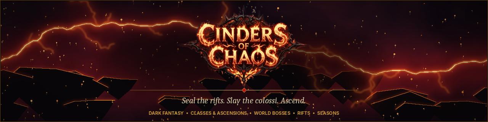

# Project Chaos

> *The world was not ended. It was broken, and the pieces still bleed.*

> Once there was one world. Then the sky split, and the **Chaos** came through the wound.
> It did not end the world. It broke it into drifting shards, and through every crack it still bleeds: into the beasts
> of the deep hunting grounds, into the orbs that reshape steel, into the **rifts** that open wherever a Rift Key turns.
> Five colossi came with it. Kaelgor, Skaldra, the Rotmother, Nyxareth and Vharok still answer every portal that opens
> at the temples, and the guilds still bleed for the **Chaos Obelisk**.
> Against them stand those who take up the sword, the bow, the spell or the shadow. At the hundredth step of their road
> the **Ascendant Oracle** shows them two paths, and they leave as something more than they came.
> The ash is still falling. This is the **Season of Ash**.

Project Chaos is a dark fantasy Open Tibia server (protocol 10.98) with its own client. It keeps the classic top-down
hunt-and-loot game and adds the depth of an action RPG: classes with ascensions, a huge passive tree, items with
rarities and modifiers, crafting orbs, monsters that roll affixes, and endgame systems built for weeks of play rather
than days.

---

## At a glance

| | |
|---|---|
| Protocol | 10.98, with our own client (custom UI skin, top menu, windows for every system) |
| Classes | 4 base classes, each with 2 ascensions (8 ascended classes) |
| Level cap | 1000, then Paragon levels. Reaching 1000 takes roughly 100 hours of hunting |
| Items | 15 rarities from Common to Transcendent, item levels, random modifiers, about 50 uniques |
| Endgame | world bosses, bounties, a bestiary with kill tasks, rifts with keys and modifiers, the Infinity Tower, dungeons, arena, guild siege, guild levels and guild halls, invasions and world events, weekly leaderboards |
| Fair play | multi-client rules, staff characters left out of every leaderboard |
| World art | our own dark tile set (cracked obsidian, ash, bones, wet rock, glowing fungus, braziers) in rifts, the world boss arena and the ascension trial |

---

## Your first steps

> *"Nobody dies on the island. It is the last kindness this world will show you."*
> (from the Chronicle of the Broken World)

- **Tutorial island:** new characters start on a small island with five stations: fight, cast your first spell, spend
  a passive point, use a Chaos Orb, and learn about keystones, bounties and the store. Each station opens the next
  gate. You can skip it any time (Character > Services > Leave Tutorial), and nobody can die there.
- **Starter kit per class:** weapon, armour, potions, food, tools, a temple teleport scroll and some gold, chosen for
  your class: arrows for Rangers, a second dagger for Ninjas, and so on.
- **Milestone gifts** at levels 20, 50, 100 and 200: potions for your role and Chaos Orbs.

## Classes

> *"Steel, string, spell or shadow. Choose one. At the hundredth step I will ask you to choose again."*
> (the Ascendant Oracle)

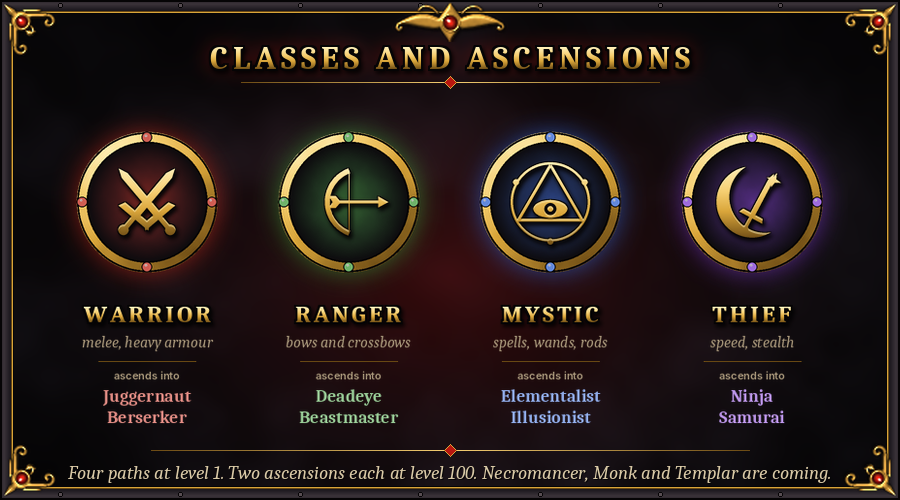

You start as one of four base classes. At level 100 you **ascend** into one of two specialisations through a quest: the Ascendant Oracle in the temple sends you to prove your strength against rare and legendary monsters, then into a trial against your class's guardian, and only then lets you choose.

| Base class | Plays as | Ascensions |
|---|---|---|
| **Warrior** | melee, heavy armour, most health | **Juggernaut**: the tank, with taunts, damage reduction and block/reflect · **Berserker**: two-handed area damage; *Rage* hits harder the lower your health, *Skyfall Cleave* leaps in and slams the ground |
| **Ranger** | bows and crossbows | **Deadeye**: the best single-target damage in the game, with crossbows, marks and crits · **Beastmaster**: fights beside a *War Wolf* companion that grows with you (two wolves from level 400) |
| **Mystic** | spells, wands and rods | **Elementalist**: the best area damage, with fire, ice and energy combos · **Illusionist**: the best healer (Mirror Mend, Lucid Reverie, party heals), plus party attack buffs; weakens enemies |
| **Thief** | fast light weapons, shurikens, stealth | **Ninja**: dual-wields daggers with a scripted off-hand strike, plus Shadow Step · **Samurai**: one sword, counter stance, Iaijutsu draw strike and Bushido crit stacks |

Every class has its own Chaos spells with custom names, icons and effects, and the spellbook (Character > Spellbook) lists them all.
Balance is measured on test dummies at levels 300 and 1000, so every class keeps a clear role in a group.

## Passive tree and Paragon

> *"Six hundred stars, and never enough light to reach them all. No two heroes draw the same constellation."*
> (from the Chronicle of the Broken World)

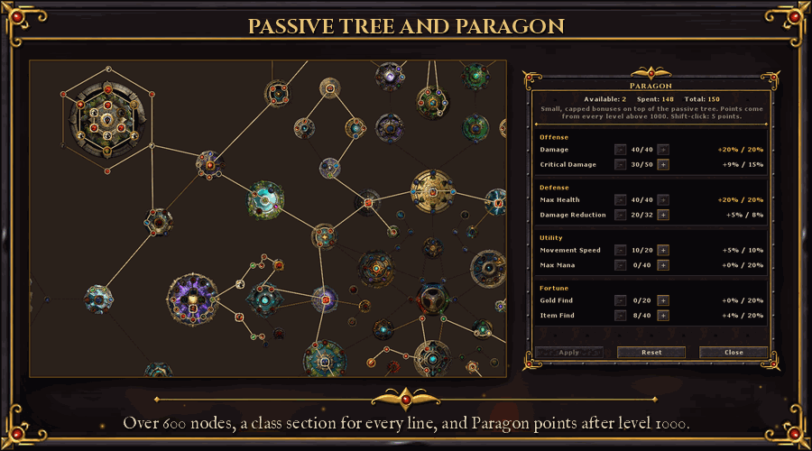

- **Passive tree:** over 600 nodes, with points from levels and not enough to take everything, so every build is a
  choice. Class **keystones** change how you play:
  - *Cleaving Arc*: two-handed hits strike everything around you
  - *Ricochet*: arrows bounce to another target
  - *Arcane Echo*: spells can cast a second time
  - Illusionist party auras
- **Build codes:** export your tree as a short code (the passive tree's Build Code panel) and import someone else's. The tree previews it
  first, with the points needed against the points you have.
- **Respec:** right-click a node to refund just that node, or reset the whole tree. Both are priced by your level: a
  full reset costs about 35-40 minutes of hunting gold. Resets are free below level 50 and once after a class change.
- **Paragon:** after level 1000 every level gives a Paragon point. You spend them on small, capped bonuses in four
  categories, so there is always something to gain.

## Items and loot

> *"The Chaos seeps into everything it touches. Most of it is rust. Some of it glows."*
> (a scavenger of the deep hunting grounds)

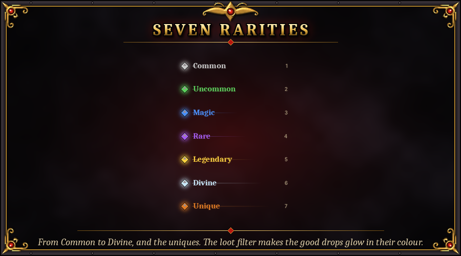

- **15 rarities**: Common, Uncommon, Rare, Epic, Legendary, Exotic, Mythic, Chaos, Eternal, Divine, Phantasmal,
  Celestial, Cosmic, Abyssal and Transcendent.
- **Item levels:** every piece of gear that drops has an item level from 1 to 150. It comes from what dropped it: the
  monster's level, plus a bonus for Magic, Rare and Legendary monsters, bosses, the rift's tier and Omen guardians. World
  boss gear is item level 145. Orbs never change an item's level.
- **Rarity decides how many modifiers, item level decides how good they are.** A Common item has one prefix and one
  suffix; top rarities carry up to three of each (Rare to Exotic: two of each; Mythic and above: three). **Prefixes** are
  damage and defence (skills, critical hits, element damage, ailments, penetration, block, dodge, thorns ...),
  **suffixes** are utility, resistances and speed (absorbs, leech, attack and movement speed, find bonuses, cooldown
  reduction ...).
- **Modifier tiers T1 to T8:** each modifier rolls a tier, T1 the lowest and T8 the highest, each with its own value range.
  A tier needs an item level (T2 at 15, T3 at 30, T4 at 50, T5 at 70, T6 at 95, T7 at 120, T8 at 140), and higher tiers
  are rarer, so gear from stronger monsters rolls better. Older items keep their values; their tier is read from the value.
- **The modifiers:** elemental damage, absorbs, skills, critical hits, life and mana leech, attack speed (weapons),
  movement speed (boots), damage to elites and bosses, life and mana on kill, health and mana on hit, dodge, block
  (shields), reflect, thorns, chance to bleed, ignite, poison, chill or shock, physical and elemental penetration, execute
  (monsters below a share of their health die to your hit; never bosses), damage over time, cooldown and mana cost
  reduction, health regeneration, experience, gold find, item find, rarity find, treasure goblin chance, healing done and
  less damage from monsters. Every modifier has a cap for your whole equipment. They show with their tier in the item's
  description, in the loot channel and on the Crafting Bench.
- **About 50 uniques** with fixed, build-defining stats. Some only drop from bosses.
- **Vocation Trials:** every vocation has a themed trial (talk to the Keeper of Trials in the temple, or press Trials in
  the Passive Tree window): a solo, timed arena fight with three lives (Normal at level 100, Cruel at 250, Merciless at 400).
  Each tier you clear opens one pair of special passives, and you hold only one of each pair: Berserker's Bloodlust or
  Cleaver's Hunger, a Ninja's Twin Fangs or Shadow Flurry, a Mystic's Overchannel or Thrifty Weave... Every choice has a
  trade-off. Changing your mind costs a Trial Token (earned by repeating a trial) and gold. They don't use passive points
  and survive tree resets.
- **Map overlay:** press **Tab** to lay a see-through map over the game view, centred on your character, with icons for your
  party, the temple, depots and NPCs, rift exits and guardians, treasure goblins, world bosses and invasions. While it is
  open: mouse wheel (or +/-) zooms, **Ctrl + wheel** changes the opacity, and holding the **middle mouse button** while
  dragging pans the map (Shift + arrow keys work too, Ctrl + Shift + arrows while the chat is on). **Home** (Ctrl + Home with
  chat on) or the **Centre** button of the small control strip in the bottom right returns to your character; the strip also
  has opacity and zoom buttons and a Close button, and everything else stays click-through so you keep playing. While you are
  panned the strip says so and your character keeps a marker. The pan resets when the overlay closes or a rift run starts.
  Opacity, the strip and the corner-box mode are in Hunt > Map Overlay Settings; the Centre key is in Options > Hotkeys.
  Inside a rift the layout fills in as you explore it.
- **Rich item tooltips:** hover an item to see its rarity, item level, its prefixes and suffixes, every modifier with
  its tier ("T5") and the value range of that tier,
  sockets and gems, unique set and requirements. Hold **Ctrl** to compare it with what you are wearing, stat by stat in
  green and red. Item slots are framed in their rarity colour.
- **Monster tiers:** every spawn can roll **Magic, Rare or Legendary**, each tougher and better-rewarded. Tiered
  monsters get modifiers such as *Blazing, Chilling, Venomous, Vampiric* or *Berserker*. Killing one can trigger an
  **ambush**.
- **Treasure goblins:** a very rare, cowardly goblin that flees, blinks away and taunts you, then escapes 18 seconds
  after the first hit. Catch it in time for a hoard of gold, orbs and rarity gear.
- **Loot filter** (Hunt > Loot Filter): items glow in their rarity colour in corpses, and junk below your chosen rarity is
  dimmed. You can switch whole categories off, make gear glow when it carries a modifier of a chosen tier (say T7+)
  whatever its rarity, or pick a preset: Show all, Hunter or Strict.
- **Loot channel with icons:** every kill gets a row of item icons. Click an icon to loot it (Shift+click for one from
  a stack). Looted items grey out.
- **Loot rays:** a beam of light rises from corpses holding a unique or a Legendary-or-better item, coloured by
  rarity.
- **Rarity Autoloot** (store unlock): pick up gear by rarity even when it isn't on your autoloot list, and leave the
  junk behind.
- **Autoloot, auto seller, bank and stash** so you spend your time hunting, not walking.

## Crafting

> *"Every orb is a splinter of the break. Press it to steel, and the steel forgets what it was."*
> (from the Chronicle of the Broken World)

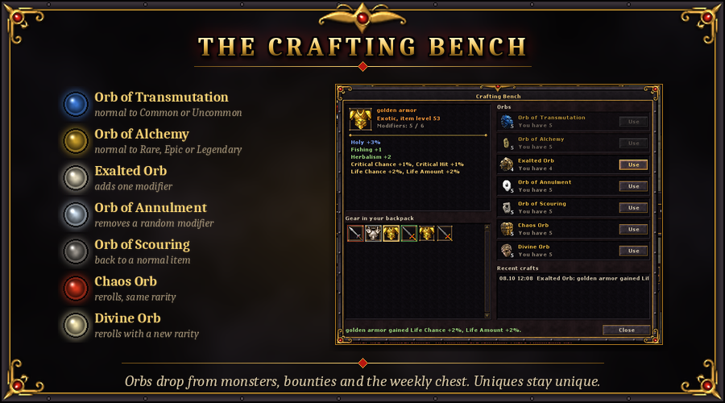

Orbs reshape your gear and your Rift Keys. Use them like any other tool: **"Use with" on the orb, then click the item**
in your backpack. No bench needed. The **Crafting Bench** (Economy > Crafting Bench) is still there when you want to see an item's
modifiers and a preview of what each orb would do before you use it.

| Orb | On gear | On a Rift Key |
|---|---|---|
| Orb of Transmutation | a normal item becomes Common or Uncommon | a key without modifiers gets one |
| Orb of Alchemy | a normal item becomes Rare, Epic or Legendary | a key without modifiers gets two or three |
| Exalted Orb | adds one modifier on an open prefix or suffix, its tier by the item level | adds one modifier, up to three |
| Orb of Annulment | removes one random modifier | removes one random modifier |
| Orb of Scouring | turns the item back into a normal item | removes every modifier |
| Chaos Orb | rerolls every modifier, same rarity and item level | rerolls the key's modifiers |
| Divine Orb | rerolls the item with a new random rarity (same item level) | rerolls the values of the key's modifiers |

A Rift Key's modifiers make the rift harder and its rewards better, so crafting a key is how you push for more loot.
Items must sit in your backpack (not equipped). Orbs drop from monsters (more from tiered ones and bosses), from
bounties and the weekly chest, and can be bought in the store. Uniques can't be crafted, so they stay unique.

### Gems and sockets

Gear can have up to three **sockets**: more on two-handed weapons and body armour, more at higher rarities. They drop
on rarity gear, and the **Orb of Sockets** rolls a new number for any piece. **Gems** come in seven kinds and five
qualities (Chipped, Flawed, Polished, Flawless, Perfect). Each gem does something different in a weapon, in armour and
in jewellery:

| Gem | Weapon | Armour | Jewellery |
|---|---|---|---|
| Ruby | fire damage | max health | fire resistance |
| Sapphire | ice damage | max mana | ice resistance |
| Emerald | earth damage | movement speed | earth resistance |
| Amethyst | critical hits | death resistance | death damage |
| Topaz | attack speed | energy resistance | energy damage |
| Diamond | holy damage | all elemental resistances | holy resistance |
| Onyx | life leech | physical resistance | physical damage |

"Use with" a gem on your gear to socket it, or on a gem of the same kind to turn three into one of the next quality.
At the Crafting Bench you can take a gem out for gold, or shatter it for free. Gems drop from monsters (better ones from
higher levels, elites and bosses), and come from bounties, rift chests and world bosses. Uniques have one socket of
their own.

### Salvage

Gear you will never wear is not just vendor trash. The **Salvage** tab of the Crafting Bench (Economy > Salvage) breaks an
item with a rarity into **Rune Shards** (more for higher rarities and item levels, one more per T6-or-better modifier
and per empty socket) with a small chance of a whole orb, and turns shards into orbs: 12 for an Orb of Transmutation, 25 for a
Chaos Orb, up to 100 for an Exalted Orb. Salvage one item, or a whole bag up to the rarity you choose (50 items at a
time, after a confirmation). **Lock** the pieces you want to keep on the bench: salvage and the Auto Seller never touch
a locked item. Uniques and items with gems in their sockets are never salvaged.

## Endgame

> *"Five came through the first wound. Whenever the portals open at the temples, they come back, and never weaker."*
> (from the Chronicle of the Broken World, the Book of the Five)

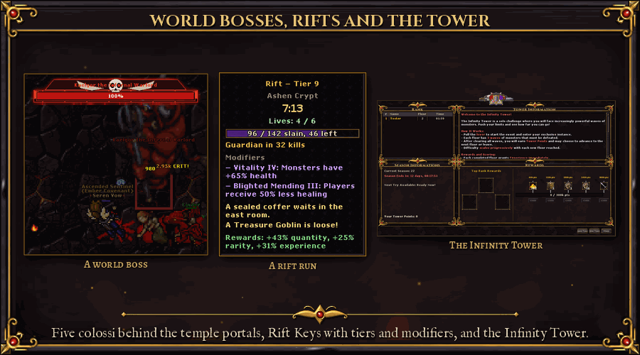

- **World bosses:** a server-wide event. A portal opens at every temple and one of five colossal bosses appears:
  - Kaelgor the Infernal Warlord
  - Skaldra the Rime Queen
  - The Rotmother
  - Nyxareth the Void Archon
  - Vharok the Blood Colossus

  Each has phases and 15 to 24 million health. Everyone who takes real part gets a reward, not only the last hit:
  damage on the boss, healing other players and tanking the boss's blows all count, so a healer or a tank is
  rewarded like a damage dealer. The top 3 in damage, in healing and in tanking get extra orbs, a better chance at a
  boss unique and a title for a week: Bossbreaker, Lifewarden or Bulwark. The weekly Boss Healer and Boss Tank
  leaderboards rank the best healers and tanks.
- **Bounty board** (Adventure > Bounty Board): daily "kill X in Y" contracts per level band that pay orbs. Finish seven in a week
  for the weekly bounty chest.
- **Rifts** (Adventure > Rifts): use a **Rift Key** to open a 10-minute instance for you and up to 3 party members.
  - Each key has a tier (1-15) and 1-3 random modifiers, such as *Vitality, Brutality, Haste, Elites, Reflection,
    Warding, Withering* or *Swarm*. Harder modifiers raise the rewards: item quantity, rarity and experience.
  - Clear the packs and the **Guardian** appears. Kill it to seal the rift, and its chest pays gold, Chaos and Divine
    Orbs and gear for every finisher.
  - A sealed rift can drop the next tier's key. Keys also drop from tiered monsters and bounties.
  - A crash refunds your key.
- **Infinity Tower** (Adventure > Infinity Tower): climb floor after floor alone or with a party of up to 4, against the clock.
- **Dungeons:** instanced runs with their own progress.
- **Late game:** 17 level-scaled Chaos monsters (levels 650-1000) live in the deepest hunting grounds. Experience
  stages are tuned so the road to 1000 stays rewarding.
- **Invasions** (Adventure > Events): a few times a week a horde of orcs, undead, demons or minotaurs falls on a town or a
  hunting ground. It comes in five waves and marches on the town's heart, and its warlord leads the last wave.
  - Everyone can defend. The bar at the top left shows the wave, the invaders left, the time and the **breach
    meter**, which fills while invaders stand at the target.
  - Hold it and everyone who fought is paid by their part in the defence: damage, kills, and healing for healers.
    The pay is gold, Chaos and Divine Orbs and a chance at a unique, plus points on the weekly **Defender**
    leaderboard. The whole world gets +10% experience for an hour.
  - Lose it and the invaders occupy the place for 30 minutes. Slay the occupiers to free it for a smaller reward.
  - Warnings come 30, 10 and 1 minutes before. The calendar shows the fixed invasion days, but some invasions come
    unannounced.
- **World events** every few hours, somewhere in the world:
  - a *Chaos Storm*: three times as many magic, rare and legendary monsters for 15 minutes
  - a *Wandering Merchant* who sells orbs cheaply for 20 minutes; the town is announced, you have to find him
  - a *Golden Hour*: +25% loot in one area for 30 minutes
- **Events calendar:**
  - *Blood Moon* weekends: +50% experience
  - *Chaos Rift* Wednesdays: double tiered spawns
  - *Loot Frenzy* Fridays
  - a daily boosted creature and boss

## Seasons

> *"The ash falls, the ladder is swept clean, and new names climb it. The ash remembers who reached the top."*
> (from the Chronicle of the Broken World, on the Season of Ash)

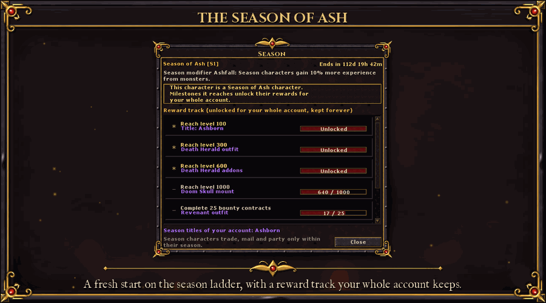

Start fresh with a **season character** (Adventure > Season, Join, on a new character) and race on the season ladder.
- **Own economy:** season characters trade, mail, party and loot only with their own season.
- **Season uniques:** some uniques drop only for season characters while the season runs, then for everyone.
- **Reward track:** outfits, addons, mounts and titles for milestones (level 100 / 300 / 600 / 1000, bounties, world
  bosses, rifts), unlocked for your whole account and kept forever.
- **Season end:** season characters join the normal world with everything they earned.

## PvP

> *"The Obelisk does not care whose banner flies over it. It only counts the seconds you hold it."*
> (a Siege Champion)

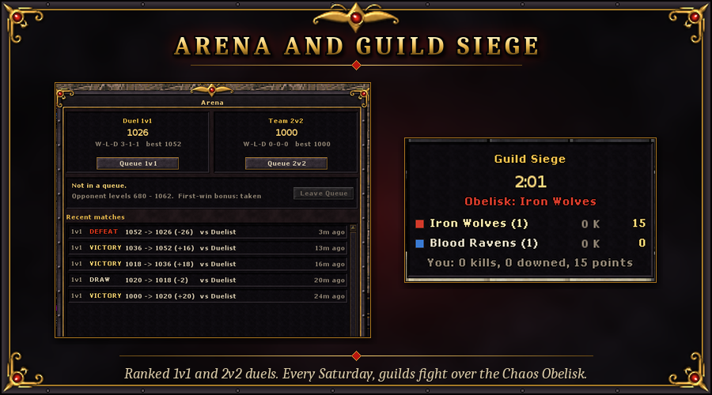

- **Ranked arena** (Adventure > Arena): **1v1 and 2v2** with an Elo rating per mode.
  - Matchmaking pairs players of close rating and similar level.
  - Nobody really dies and there are no skulls: a lethal hit sends the loser to the gallery.
  - Each win pays a Chaos Orb, and the first win of the day pays a bonus.
- **Guild Siege** (Adventure > Guild Siege): every Saturday at 20:00, up to four guilds per arena fight over the **Chaos Obelisk**.
  - You score by striking enemies down and by holding the obelisk.
  - Nobody really dies.
  - The winners become **Siege Champions** for a week: a title and +5% experience.

## Guilds and guild halls

> *"A banner is only cloth. A hall is where the guild remembers its dead and counts its gold."*
> (a guild steward)

Your guild grows with you. Open the **Guild** window (Social > Guild) to see its level, your members and
what everyone has contributed this week.
- **Guild levels (1-20):** the guild earns guild XP from what its members already do: a small share of your hunting
  experience (capped each day), bounty contracts, sealed rifts, world bosses, defended invasions and the guild siege.
- **Perks for online members**, small but always on: up to +5% experience and +5% loot, cheaper respecs, a free guild
  hall scroll every day, more guild depot space and a guild aura.
- **Guild bank:** every member can deposit gold; the leader can withdraw it. Every movement is logged.
- **The guild hall** (from guild level 5): the leader buys it, and members step through the portal next to the temple
  to reach it. Nobody else gets in.
- **Hall upgrades:** a teleport hub to the hunting grounds, a training room with exercise dummies, a crafting bench,
  a **guild depot** shared by the members (with a log of who put in and took out what), a trophy room with your siege
  wins, world boss victories and records, and three decoration tiers.
- **Rent:** the hall costs a weekly rent from the guild bank. If the bank runs dry the upgrades lock until it is paid;
  nothing is ever lost.
- **Top guilds:** a weekly board of the guilds that earned the most guild XP.

## Leaderboards and titles

> *"Every Monday the stone is wiped and the names are carved anew. Only the titles linger, for one week."*
> (from the Chronicle of the Broken World)

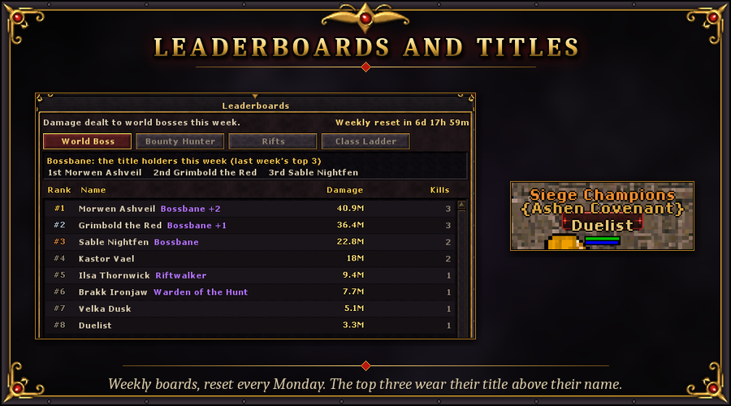

Weekly boards (Social > Leaderboards) reset every Monday:
- World Boss damage
- Bounty Hunter
- Rifts
- Goblin Slayer
- Guild Siege
- Arena 1v1 and 2v2
- Defender (invasions defended)

The top 3 of each board earn a **title** for the next week (Bossbane, Warden of the Hunt, Riftwalker, Goblin Slayer,
Siegebreaker, Duelist, Gladiator, Defender of the Realm) and orbs. The all-time **Class Ladder** ranks the highest characters of every class.

### Name plates and titles

Above every player floats a name plate: their **title** on top, their **guild** in braces below it, and their **name**
on a small framed plate. Titles come from the leaderboards (gold), the guild siege (Siege Champions, orange, with a
crimson plate), seasons, login streaks and achievements; staff wear red titles on a gold plate. Hold several? Pick one, or none, in
the Achievements window (Character > Achievements). Monsters and NPCs keep their plain names.

## Chat item links and inspecting players

- **Show off an item:** with the chat input active, **Shift + click** an item in your inventory or a backpack. Its name
  appears in the message as `[Item Name]` (up to 3 per message); write the rest and send it. Everyone who gets the message
  (say, party, guild, a channel, a private message) sees the name in the item's rarity colour (uniques in orange). **Hover**
  it to see the same tooltip you get in your own backpack, and hold **Ctrl** to compare it with what you wear. A link shows
  the item as it was when you linked it and lasts 10 minutes. You can only link items you carry (not items on the ground or
  in the depot). Locked items can be linked. Links are not allowed in the Help channel or in NPC conversations.
- **Inspect a player:** **Ctrl + right-click** (or right-click, depending on your controls) a player and choose
  **Inspect Player**, or open **Social > Inspect Player** and type the name of anyone who is online. The window shows their
  outfit, level, class, guild, achievement points, best rift and Vocation Trial, and every worn item with its tooltip.
  Nothing else is shown: no health, skills or passive tree. Staff who are hidden cannot be inspected.
- **Privacy:** the checkbox **Allow others to inspect me** in the Inspect Player window switches it off for your character
  (on by default). Others then see that you do not allow it.

## Achievements

> *"I write down every deed. A few of them I may not write down until someone has done them."*
> (the Chronicler)

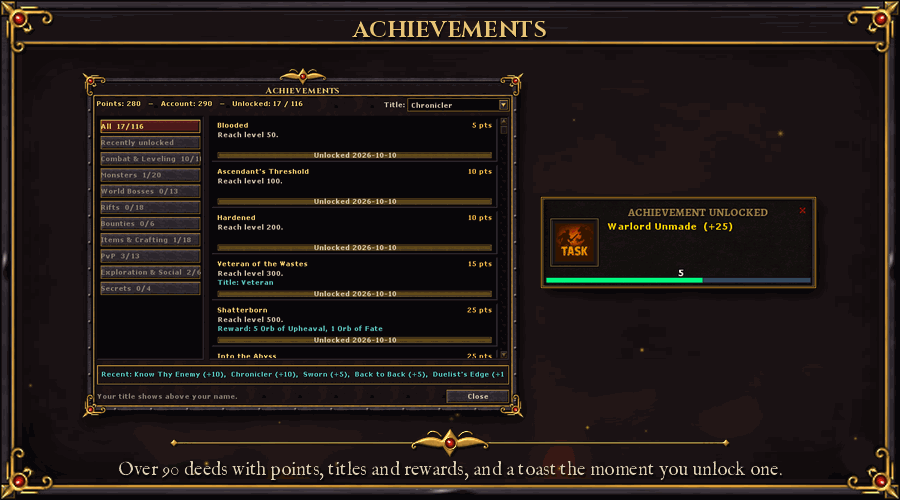

Over 90 achievements (Character > Achievements) give you goals in every corner of the game:
- **What counts:** levels and Paragon, magic, rare and legendary kills, ambushes, Treasure Goblins, each world boss, rift
  tiers and modifiers, bounty contracts and weekly chests, uniques and rarities found, orbs used at the Crafting Bench,
  arena wins and ratings, guild sieges, and a few secrets that stay hidden as **???** until you find them.
- **Points:** every achievement is worth points. Your account total counts each achievement once, whichever character
  earned it.
- **Titles:** many achievements give a title to show above your name. Pick one in the window.
- **Rewards:** some pay orbs, others an outfit with its addons or a mount.
- **Already a veteran?** Levels, Paragon, ascension, bounties and arena results you had before are counted the next time
  you log in.
- The window shows your progress on each one, and a toast pops up the moment you unlock one.

## Pets

> *"It will not fight for you. It will not die for you. It will, however, steal from the dead on your behalf."*
> (a pet trader in the lower city)

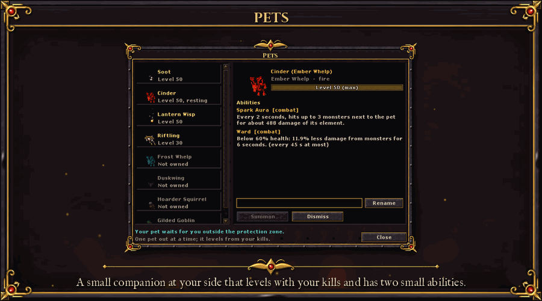

A pet is a small companion that walks at your side (Character > Pets). It cannot fight and cannot be hurt, and
only one is out at a time.
- **Getting one:** whelps drop very rarely from dragons and frost dragons, the Duskwing from any monster worth your time
  (more often from magic, rare and legendary ones), the Lantern Wisp and the Hoarder Squirrel are in the store (Pets),
  and the Ash Cat, the Gilded Goblin and the Riftling come with achievements. Finding a pet you already have gives yours
  experience instead.
- **Levels:** your pet levels with your kills, up to level 50. Monsters far below your level do not count; magic, rare,
  legendary monsters and bosses count more.
- **Abilities:** every species has two small ones, the second from level 20: **Mend** (heals you when you drop below half
  health), **Ward** (less damage from monsters for a few seconds when you are hurt), **Spark Aura** (hits the monsters
  next to it that are after you), **Gold Sniffer** (more gold in your kills), **Treasure Sense** (more item find) and
  **Fetch** (carries the gold of your kills straight to your bank).
- **Names:** give it a name with the window's Rename button.
- **Where:** pets wait outside protection zones and stay home from the arena, the siege and PvP zones. In rifts, the
  Infinity Tower, dungeons and the world boss arena only the gold, item find and fetch abilities work. While you have
  other summons out your pet stays back; class companions (wolves, minions) do not mind it.
- If you die, your pet runs off and needs a minute before you can call it again. Log out with it at your side and it is
  back when you return.

## Bestiary and kill tasks

> *"Write down what it eats, where it sleeps and what it fears. Then go and kill a thousand of them."*
> (the Chronicler, to a new hunter)

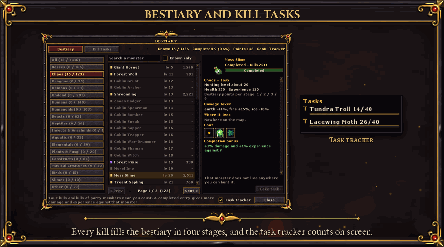

The bestiary (Hunt > Bestiary) has a page for every monster in the world, and it fills in as you hunt:
- **Stages:** your kills unlock each monster in four stages: **Discovered**, **Studied**, **Mastered** and **Completed**.
  How many kills each stage needs depends on how dangerous the monster is: a rat is done after 250, a dragon lord after
  1,000, a boss after 5 kills. Rare monsters that only live in a few places need fewer.
- **What you learn:** Discovered shows its picture, level, health and experience. Studied adds its weaknesses and
  immunities, where it lives and its rarest loot. Mastered shows its whole loot list and the Chaos uniques it can drop.
- **Completion bonus:** a completed monster takes 1-3% more damage from you and gives you 1-3% more experience.
- **Bestiary points and ranks:** every stage gives points, and so do kill tasks. Points raise your bestiary rank, from
  Novice to Monster Sage, and each rank adds a little experience from every monster (up to +3%).
- **Search** by name, browse by family (dragons, demons, undead, beasts, bosses, Chaos monsters and more), and see your
  completion in each.

**Kill tasks** (Hunt > Kill Tasks) are your own hunting orders:
- **The board** offers a few hunts and family tasks for your level every day ("kill 150 Hellspawn", "kill 270 dragons
  of level 85-189"). You can also take a hunt task from any monster you have discovered, if it suits your level.
- **Rewards:** gold to your bank, Chaos Orbs (Divine Orbs for family tasks at high levels), experience and bestiary
  points. You can hold 3 tasks at once and finish 4 a day and 20 a week.
- **Party:** kills by party members near you count for your tasks and your bestiary too.
- The **bounty board** stays the big daily board shared by everyone; kill tasks are the smaller, personal ones, and a
  kill counts for both.

The **task tracker** at the bottom right of the screen lists your kill tasks and bounty contracts with their progress,
updated with every kill. Click its title to fold it; switch it off in the bestiary window or in the Hunt menu.

## Goblins and the wildwood

Two new invasion factions bring new monsters: the **Goblin Tribe** (grunts, archers, bombers, witches, wolf riders, a
hobgoblin captain and the Goblin Chieftain) and the **Wildwood Uprising** (wolves, boars, mushroom folk, dryads, owlbears,
giant beetles and spiders, the Mushroom King and the Ancient Treant). They drop creature products you can sell to Yasir
and food you can eat. The Orbs of Alchemy, Annulment and Scouring and the mining ore pieces have new pictures.

## Quality of life

> *"Count your kills, count your coin, and come back tomorrow. The Chaos is patient. So are its rewards."*
> (from the Chronicle of the Broken World)

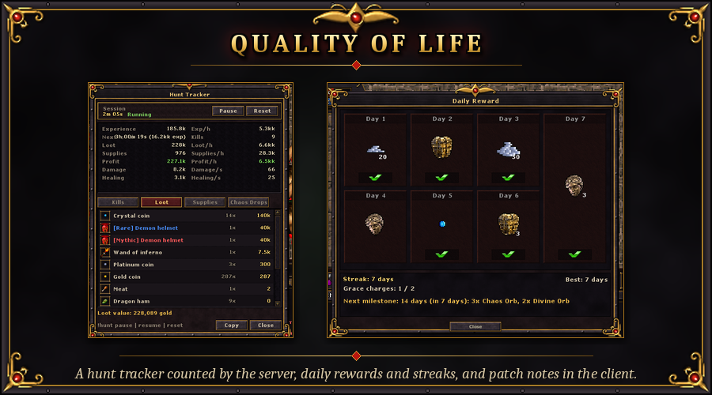

- **Combat visuals:** crits, dodges and reflects get their own sprites. Elemental weapon damage shows as a separate
  coloured number with its element's effect. Big numbers are shortened (12.4k).
- **Patch notes in the client:** a window with every week's changes. It opens once at login when there is something
  new, after the daily reward.
- **Hunt tracker** (Hunt > Hunt Tracker): experience, loot, supplies and profit per hour for your session, counted by the server.
  It also shows kills per monster, every item looted and its value, damage and healing per second, and your Chaos
  drops. Pause, reset or copy a summary.
- **Buff bar** (Character > Buff Bar): your buffs and debuffs as small icons with a countdown and a stack count, buffs on
  the top row and debuffs on a second row with a red border; hover an icon for its name, what it does and the time left.
  It covers haste, regeneration, food, poison, burning, freezing, drowning, energy, bleeding, slows, drunkenness, mana
  shield, invisibility, the fight and skull timers, your class buffs (Bushido Focus shows its stacks), world buffs, the
  Victory buff, Golden Hour and the Chaos Storm while you stand in them, the day's events, double experience, the
  stacking nodes of the Vocation Trials, the Monk's chi, the Berserker's Rage and Reprisal. Grab the strip on top to move
  it; the gear opens the size, icons per row, lock, countdown and hide-when-empty settings. Everything is shown by the
  server, so it is always right.
- **Party frames** (Hunt > Party Frames): a small movable panel with a frame for every member of your party: outfit, name
  in the class colour, level, a crown for the leader, health and mana bars with the numbers, a floor arrow and the
  distance, in a fight / dead / connection lost, and their first buffs and debuffs, updated twice a second. Members
  near you (50 squares, two floors) show exact numbers; members far away show a rough health bar. Left click selects a
  member and follows them (switch off in the gear window), shift+click looks, right click opens a menu: message, follow,
  look, pass the leadership and remove from the party (leader), invite a player by name, leave the party. The panel
  shows up when you join a party and hides when you leave; your own frame is optional. The old Hunt > Party window is
  still there.
- **Daily rewards and login streaks:** one claim a day per account. Your streak counter shows your current and best
  streak. Milestones at 7, 14, 30, 60, 100 and 180 days pay orbs, and titles at 30, 100 and 180 days ("the Devoted",
  "the Relentless", "the Undying"). Grace charges save your streak when you miss a day.
- **Waystones** with account upgrades (experience, loot, rarity), and toast notifications for
  everything that matters.
- **Town Portal:** every character has it from the start, with unlimited uses. Cast it from the action bar (the spell
  Town Portal, `ash domh`) or from Character > Town Portal. After a 3 second channel (moving or taking damage breaks it)
  a portal opens beside you that leads to your town's temple, and a return portal opens beside the temple that brings you
  back to the exact spot. One pair per character (a new one replaces the old), open for 5 minutes or until you walk back
  through it; 60 second cooldown. You and your party members can use it. It does not work in a protection zone, after PvP,
  with a skull, on the tutorial island, in arenas, the world boss arena and sieges, or inside rifts, dungeons and the
  Infinity Tower (those have their own exits).
- **Portal Style** (Character > Portal Style): pick the look of your portal and its opening and closing effects; everybody
  sees it. Six styles are sold in the store (Portal Styles) and six are earned only through achievements: Abyssal Maw
  (Colossus Hunter), Riftwalker's Gate (Keybearer), Hellmouth Gate (Herald of Omens), Hoarder's Gate (Hoardbreaker),
  Warbanner Gate (Siege Champion) and Gravecall Gate (Death Is a Teacher, a secret). A style comes by one route only.
- **Store** (Chaos Coins):
  - stamina refill, bottomless loot pouch, auto seller, portal styles
  - training weapons, server-wide world buffs
  - name, vocation and sex change, blessings, skull removal
  - passive tree reset, crafting orbs

## Coming soon

Being built right now:
- **New classes:** the **Necromancer** (Lich / Bone Lord), the **Monk** (Shadowfist / Iron Sage) and the **Templar**
  (Inquisitor / Sentinel).

The full priority list is in [ROADMAP.md](ROADMAP.md).

---

## For developers

| Document | What's in it |
|---|---|
| [server/README.md](server/README.md) | layout, install steps, every Chaos system and its settings |
| [client/README.md](client/README.md), [client/MANIFEST.md](client/MANIFEST.md) | client modules, base patches, build |
| [docs/CLASSES.md](docs/CLASSES.md) | class design and implementation status |
| [server/data/spells/README.md](server/data/spells/README.md) | spells and balance tables |
| [ROADMAP.md](ROADMAP.md) | what's done, in progress and planned |
| [docs/LAUNCH.md](docs/LAUNCH.md) | **Running a server**: install (`server/tools/install_all.py`), production config, systemd, backups, monitoring, launch checklist |
| [website/README.md](website/README.md) | the website (ZnoteX with our layout and plugin): installer, class lock on character creation, leaderboards / patch notes / seasons pages, banners and art |

This page is kept up to date as features are merged: new systems move from *Coming soon* into their sections.
