# Cinders of Chaos

> *The world was not ended. It was broken, and the pieces still bleed.*

> Once there was one world. Then the sky split, and the **Chaos** came through the wound.
> It did not end the world. It broke it into drifting shards, and through every crack it still bleeds: into the beasts
> of the deep hunting grounds, into the orbs that reshape steel, into the **rifts** that open wherever a Rift Key turns.
> Five colossi came with it. Kaelgor, Skaldra, the Rotmother, Nyxareth and Vharok still answer every portal that opens
> at the temples, and the guilds still bleed for the **Chaos Obelisk**.
> Against them stand those who take up the sword, the bow, the spell or the shadow, and now the bone, the fist and the
> flame of faith. At the hundredth step of their road the **Ascendant Oracle** shows them two paths, and they leave as
> something more than they came.
> The ash is still falling. This is the **Season of Ash**.

Cinders of Chaos is a dark fantasy Open Tibia server (protocol 10.98) with its own client. It keeps the classic top-down
hunt-and-loot game and adds the depth of an action RPG: seven class lines with fourteen ascensions, a huge passive tree,
items with rarities, item levels and modifiers, crafting orbs, spell supports, monsters that roll affixes, and endgame
systems built for weeks of play rather than days.

---

## At a glance

| | |
|---|---|
| Protocol | 10.98, with our own client: ornate UI skin, animated login screen, top menu, a window for every system |
| Classes | 7 class lines (Warrior, Ranger, Mystic, Thief, plus Necromancer, Monk and Templar as a store unlock), each with 2 ascensions: **14 ascended classes**, earned through the ascension quest |
| Level cap | 1000, then Paragon levels. Reaching 1000 takes roughly 100 hours of hunting |
| Build | a passive tree of over 600 nodes with class keystones and class sections, Vocation Trials, Paragon, spell supports, saved Loadouts |
| Items | 15 rarities from Common to Transcendent, item levels 1 to 150, prefixes and suffixes in tiers T1 to T8, legendary powers, veiled modifiers, uniques, ten item sets, gems and sockets, charms, two ring slots, and loot for every monster |
| Archery | bows and crossbows fire without arrows; quivers are off-hand gear with modifiers of their own |
| Crafting | 14 orbs plus the Orb of Unveiling, the Orb of Sockets and the Whetstone, item quality, bound modifiers, salvage into Rune Shards, and the crafting tables, whose gear can roll a rarity |
| Professions | four gathering professions up to level 100; sell the materials to the Material Broker and earn up to +10% monster experience |
| Endgame | world bosses, bounties, a bestiary with kill tasks, rifts with keys, modifiers and Omens, the Rift Atlas, Ascended Omens and the Cinderheart, the Ember Descent, the weekly raid, the Infinity Tower, dungeons, invasions and world events, community goals, four factions. Rifts, Omens and the Ascended bosses grow harder and richer for parties of up to 5 |
| PvP | ranked arena 1v1, 2v2 and 3v3 with PvP seasons, the Ember Wells battleground, the Scorched Marches open PvP zone, guild siege and guild wars |
| Social | guild levels, guild halls and a weekly guild boss, Party Finder, mentors, personal hideouts, weekly leaderboards |
| Seasons | season characters, Self-Found and Hardcore modes, a seasonal journey, a season pass |
| Economy | a player market for gold and Chaos Coins with price history, the Orb Exchange, the Gambler's sealed gear, depot tabs, store pouches, auto seller, a store that sells no gear |
| Looks | outfits, mounts, wings, auras, footprints, outlines that follow your silhouette, plate frames, transmog and pets, with 33 exclusives that are never sold, and golden wings at every level-up |
| Fair play | only the official client can play, two characters per IP at most, anti-bot checks and player reports, capped loot and experience bonuses, staff left out of every leaderboard, chances that mean what they say |
| World | 20 towns with names of our own, hunting grounds filled out for a full server, and our own dark tile set (cracked obsidian, ash, bones, wet rock, glowing fungus, braziers) in rifts, the world boss arena, the ascension trial and the guild hall |

---

## Your first steps

> *"Nobody dies on the island. It is the last kindness this world will show you."*
> (from the Chronicle of the Broken World)

- **An account on the website:** accounts and characters are made on the Cinders of Chaos website, which also has the
  leaderboards (with a tab for every class), the patch notes, the season pages, the rules and the client download.
  Play with the client from there: no other client can log in.
- **Tutorial island:** new characters start on a small island with five stations: fight, cast your first spell, spend
  a passive point, use an Orb of Upheaval, and learn about keystones, bounties and the store. Each station opens the next
  gate. You can skip it any time (Character > Services > Leave Tutorial), and nobody can die there.
- **Starter kit per class:** weapon, armour, potions, food, tools and some gold, chosen for your class: a bow that
  needs no arrows for Rangers, a second dagger for Ninjas, a katana for Samurai, nothing in the hands for Monks, who
  fight with their fists.
- **Milestone gifts** at levels 20, 50, 100 and 200: potions for your role and Orbs of Upheaval.
- **Town Portal** from level 1: a free way home and back again (see Quality of life).
- **A mentor** if you like (Social > Mentors): a veteran guides new characters up to level 79. Hunting together gives
  +10% experience and 5% less damage taken, but never when the mentor is far above the content. Mentor Marks from your
  milestones buy titles, cosmetics and potions, and graduating at level 200 rewards you both.

## Classes

> *"Steel, string, spell or shadow. Bone, fist or faith. Choose one. At the hundredth step I will ask you to choose again."*
> (the Ascendant Oracle)

You start as one of seven base classes. At level 100 you **ascend** into one of two specialisations. Every class has its
own Chaos spells with custom names, icons and effects, and the spellbook (Character > Spellbook) lists them all.

| Base class | Plays as | Ascensions |
|---|---|---|
| **Warrior** | melee, heavy armour, most health | **Juggernaut**: the tankiest class, with taunts, damage reduction and block/reflect · **Berserker**: two-handed area damage; *Rage* hits harder the lower your health, *Skyfall Cleave* leaps in and slams the ground |
| **Ranger** | bows and crossbows that need no arrows, a quiver in the off-hand | **Deadeye**: the best single-target damage in the game, with crossbows, marks and crits · **Beastmaster**: fights beside a *War Wolf* companion that grows with you (two wolves from level 400), bow shots that splash |
| **Mystic** | spells, wands and rods | **Elementalist**: the best area damage, with fire, ice and energy combos · **Illusionist**: the best healer, for one ally and for the whole party (Mirror Mend, Lucid Reverie), plus party attack buffs; weakens enemies |
| **Thief** | fast light weapons, shurikens, stealth, evasion | **Ninja**: the line's burst single target: dual-wields daggers with an off-hand strike, very fast hits, Shadow Step · **Samurai**: a duelist off-tank: one sword, a Counter Stance that parries, guards and taunts, the Iaijutsu draw strike and Bushido crit stacks |
| **Necromancer** | summoner: skeletons and spirits, curses, corpses | **Lich**: curses, damage over time, life drain and Corpse Explosion, with one strong shade or none · **Bone Lord**: the army: more skeletons, the Bone Golem, an aura and sacrifices |
| **Monk** | unarmed or with a staff, chi, evasion | **Shadowfist**: single-target burst: Pressure Points, Flurry, crits from spent chi · **Iron Sage**: the second healer, a melee chi healer with some bruiser toughness: Kindled Breath on the most hurt ally, Mantra of Stone heals and shields the party, Chi Ward |
| **Templar** | holy melee: sword or mace and shield, heavy armour, a party defence aura | **Inquisitor**: holy area damage: Judgement, Purging Nova, Zealotry · **Sentinel**: tank-support: a stronger aura with regeneration, Rebuke, Aegis of Faith and Lay on Hands, the biggest emergency heal |

**A taste of each line:**
- The **Thief** hides in *Shadow Veil* (monsters lose track of you, and the first hit out of it crits), coats its blades
  in poison and mends itself with *Shadow Mend*. The **Samurai's** Counter Stance parries the next melee hit and strikes
  back, takes every other hit 30% smaller and turns the monsters around it onto the Samurai.
- The **Necromancer** raises skeletons from empty corpses, throws a piercing *Bone Spear* and lays a *Withering Curse*.
  Its minions hit as their owner, so their kills give you full experience and loot.
- The **Monk** builds chi with its strikes (five pips over the map) and spends it on finishers that grow with the chi spent.
- Every **Templar** covers its party with a defence aura, and each of its melee hits is followed by a holy *Radiant Strike*.

### Roles in a group

| Role | Classes |
|---|---|
| Tank | Juggernaut (the tankiest), Sentinel (a little less tough, but the party takes less damage), Samurai (duelist off-tank) |
| Healer | Illusionist (the best healer), Iron Sage (the second healer, about 20% above a Mystic and below the Illusionist); the Templar aura lowers party damage |
| Single target | Deadeye (the best, at least 10% ahead), then Shadowfist, Lich, Bone Lord and Ninja |
| Area damage | Elementalist (the best, at least 15% ahead), Berserker, Bone Lord, Inquisitor |
| Pets | Beastmaster, Bone Lord |

A party with an Illusionist out-damages the same party without one. Balance is measured on test dummies at levels 300 and
1000 with a full passive tree build for every class. The latest pass kept the Deadeye and the Elementalist clearly in
front by trimming the classes right behind them, not by raising the leaders.

### The ascension quest

Ascension is earned, not bought. The **Ascendant Oracle** next to the temple leads every class through it:

1. **The Calling:** talk to the Oracle at level 100. It tells you about the two paths of your class.
2. **Proof of Strength:** slay rare and legendary monsters that are a match for your level (a rare counts 1, a legendary 3;
   you need 10).
3. **The Trial:** alone, against your class's guardian, with 180 seconds on the clock: the Warden of Iron, of the Hunt, of
   the Veil, of Shadows, of the Still Fist, of Bones or of Dawn. Each has its own tricks, such as burning marked tiles,
   punishing you for standing still, raising skeletons or enraging. Nobody dies in the Trial; a failed attempt can be
   tried again after 10 minutes.
4. **The Choice:** back at the Oracle, read both ascended classes and pick one. You get the title "Ascended" with your new
   class, and the whole server hears of it.

### The three new lines

The Necromancer, the Monk and the Templar are unlocked for your whole account in the store (category Classes). Once
unlocked, every character on the account can play them.

## Combat

> *"Count the blows you took, not the ones you gave. The Chaos keeps that ledger too."*
> (a Juggernaut of the ash wastes)

Most of the fight is the classic one. A few rules are our own, and you will notice them:

- **Energy shield:** a second bar above your health that only items give (the *Maximum Energy Shield* and *Faster Energy
  Shield Recharge* modifiers). Hits take the shield first, then your health. It refills by itself two seconds after the
  last hit you took; healing never fills it. Casters get the most from it.
- **Percent armour:** your armour takes a share of every physical hit (100 armour about 29%, 200 armour about 44%, at most
  80%) instead of a flat amount. Elemental damage is not reduced by armour; resistances handle that. High-level monsters
  hit a little harder to keep the late game honest.
- **Crits and leech that mean what they say:** a 10% chance fires on 10% of hits. Critical hits, dodges, blocks and
  reflects show their own effect over the target.
- **Attack speed:** nobody swings faster than once a second, and leech heals at most about once a second, however many
  hits land.
- **Weapon styles:** two-handed weapons swing slower and hit much harder; bow shots splash onto the creatures around
  the target, crossbow bolts hit only their target. Bows and crossbows never run out of shots (see Archery and quivers).
- **Cast times for the big spells:** Doomtide and Primordial Squall take 1.5 seconds to cast, Hail of Dawn and Colossus
  Fall 1 second, and hit harder for it. A cast bar over your character counts down (other players see a small one over
  you). Moving, a paralysis, casting another spell, opening a town portal or dying interrupts the cast and gives you the
  mana and the cooldown back; so does clicking the bar. Taking damage does not interrupt.
- **PvP healing:** every heal on a player who is in a PvP fight is 30% weaker, for every class, so fights end.

## Archery and quivers

> *"I stopped counting arrows the day my bow stopped asking for them."*
> (a Deadeye of the ash wastes)

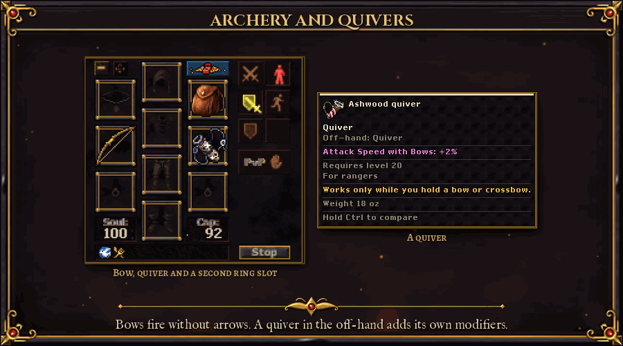

- **No more arrows or bolts.** Bows and crossbows fire on their own. Each one carries the damage of the ammunition its
  level used to need, so nothing got weaker. Arrows and bolts are gone from shops and loot, and any you had were
  turned into gold in your bank. Spears, stars and throwing knives stay as they were.
- **Quivers go in the off-hand,** next to a bow or crossbow. They only work while you hold one, so they are Ranger,
  Deadeye and Beastmaster gear. Twelve quivers from level 20 to level 1000 each carry a fixed bonus, and on top of that
  they roll modifiers of their own: *Distance Fighting*, *Critical Strike Chance with Bows*, *Extra Projectile Chance*
  (a second shot at a nearby monster), fire, ice, energy or earth damage added to your shots, and *Attack Speed with
  Bows*. Quivers drop like any gear, can be crafted with a rarity and turn up at the Gambler for bow classes.
- **A second ring slot.** The old ammunition slot now takes a ring. Both rings count in full: modifiers, legendary
  powers, gems, item sets. Two copies of the same ring are fine, but only one might ring at a time. Drag a ring onto
  the other slot to swap them.

## Passive tree, Vocation Trials and Paragon

> *"Six hundred stars, and never enough light to reach them all. No two heroes draw the same constellation."*
> (from the Chronicle of the Broken World)

- **Passive tree:** over 600 nodes and one point every four levels (about 248 at level 1000), so you can never take
  everything and every build is a choice.
- **Boss points:** the first kill of each great boss gives one more passive point, ten in all: the five world bosses, your
  Ascension Trial's warden and four ancient demon lords of the deep world.
- **Keystones that change how you play.** Two keystones at the edge of the tree take a different form for each class:

  | Class | Wrath | Resolve |
  |---|---|---|
  | Warrior | *Cleaving Arc*: two-handed hits strike the enemies around you | *Bulwark*: block with a shield, reflect melee damage |
  | Juggernaut | *Immovable*: less damage taken, twice as much below half health | *Bulwark* |
  | Berserker | *Cleaving Arc* | *Undying Rage*: melee hits heal you, more below half health |
  | Ranger | *Ricochet*: bow shots bounce to another target | *Deadeye*: crossbow shots that deal double damage |
  | Deadeye | *Hunter's Focus*: each hit on the same target hits harder | *Deadeye* |
  | Beastmaster | *Ricochet* | *Pack Alpha*: your companions bite harder and take less |
  | Mystic, Elementalist | *Arcane Echo*: area spells can cast a second time | *Elemental Overload*: switch elements for more damage |
  | Illusionist | *Shared Phantasm*: marked enemies take more from your party, and the party heals from it | *Inspiring Illusion*: a party damage aura |

- **Class sections:** the Thief, Necromancer, Monk and Templar lines each have a section of their own, with three line
  nodes and a path for each ascension that ends in a keystone. Six points reach one:

  | Ascended class | Keystone |
  |---|---|
  | Ninja | *Living Shadow*: a dodge, or the first hit out of Shadow Veil, opens 4 seconds of harder hits |
  | Samurai | *Way of the Blade*: Counter Stance parries every melee hit while it lasts |
  | Lich | *Hoarded Souls*: Soul Hoard grows with every empty shade slot |
  | Bone Lord | *Bone Colossus*: the Bone Golem hits 60% harder and has 50% more health |
  | Shadowfist | *Hundred Hands*: focus crits also give chi |
  | Iron Sage | *Flowing Mercy*: Kindled Breath also heals the next most hurt party member |
  | Inquisitor | *Divine Verdict*: Radiant Strikes judge their target |
  | Sentinel | *Bastion*: a stronger, wider aura, and Aegis of Faith covers the party |

  Before you ascend, both paths show as locked, so you can plan ahead.
- **Build codes:** export your tree as a short code (the passive tree's Build Code panel) and import someone else's. The
  tree previews it first, with the points needed against the points you have.
- **Respec:** right-click a node to refund just that node, or reset the whole tree. Both are priced by your level: a
  full reset costs about 35-40 minutes of hunting gold. Resets are free below level 50 and once after a class change.
- **Vocation Trials:** every class has a themed trial (talk to the Keeper of Trials in the temple, or press Trials in
  the Passive Tree window): a solo, timed arena fight with lives (Normal at level 100, Cruel at 250, Merciless at 400).
  Each tier you clear opens one pair of special passives, and you hold only one of each pair: Berserker's Bloodlust or
  Cleaver's Hunger, a Ninja's Twin Fangs or Shadow Flurry, a Mystic's Overchannel or Thrifty Weave... Every choice has a
  trade-off. Changing your mind costs a Trial Token (earned by repeating a trial) and gold. They don't use passive points
  and survive tree resets.
- **Loadouts** (Character > Loadouts, or the Loadouts button of the passive tree): save whole builds and switch between
  them. A loadout holds the passive tree, the Paragon points, the support runes in your spells, an equipment set and
  your action bar. Three slots, a fourth at level 200 and a fifth at level 500, earned and never sold. Switching is free,
  out of combat and outside instances, with a short channel outside protection zones. A saved tree was paid for once,
  so a switch never dodges a respec price.
- **Paragon:** after level 1000 every level gives a Paragon point. You spend them on small, capped bonuses in four
  categories (Offense, Defense, Utility and Fortune: damage, critical damage, health, damage reduction, movement speed,
  mana, gold find and item find), so there is always something to gain.

## Spell supports

> *"A spell is a promise. A rune in its socket is the fine print."*
> (a rune-carver of the lower city)

Your class decides which spells you have; **spell supports** decide how they work. Every spell gets up to three support
sockets (the second opens 60 levels after you learn the spell, the third 150 levels after, for two Orbs of Sockets), and
**support runes** go into them. Open the window with Character > Spell Supports or the Supports button of the spellbook.

- **Twenty supports**, among them: *brands* that turn part of a spell's damage into fire, ice, holy, death or energy;
  *Quickening* (shorter cooldown) and *Thrift* (cheaper); *Echo* (the hits strike again), *Fork*, *Breadth*, *Shatter*,
  *Deathburst* and *Surge* (more targets); *Keen Edge* (crits); *Bloodthirst* and *Siphon* (life and mana); *Sunder*
  (ignores resistance); *Hex* (marked monsters take more from everyone); *Reprisal* (strikes back); *Mercy* (stronger heals).
- **Five levels**, from Common to Mythic. Three runes of one support and level combine into one of the next.
- Runes drop from monsters (more from tiered ones and bosses), from rift chests and from bounties. The store sells none.
- Your action bar shows a coloured pip for each rune on a spell.

## Items and loot

> *"The Chaos seeps into everything it touches. Most of it is rust. Some of it glows."*
> (a scavenger of the deep hunting grounds)

- **15 rarities**: Common, Uncommon, Rare, Epic, Legendary, Exotic, Mythic, Chaos, Eternal, Divine, Phantasmal,
  Celestial, Cosmic, Abyssal and Transcendent.
- **Item levels:** every piece of gear that drops has an item level from 1 to 150. It comes from what dropped it: the
  monster's level, plus a bonus for Magic, Rare and Legendary monsters, bosses, the rift's tier and Omen guardians. World
  boss gear is item level 145. Orbs never change an item's level.
- **Rarity decides how many modifiers, item level decides how good they are.** A Common item has one prefix and one
  suffix; top rarities carry up to three of each (Rare to Exotic: two of each; Mythic and above: three). **Prefixes** are
  damage and defence (skills, critical hits, element damage, ailments, penetration, block, dodge, thorns, energy shield
  ...), **suffixes** are utility, resistances and speed (absorbs, leech, attack and movement speed, find bonuses,
  cooldown reduction, shield recharge ...).
- **Modifier tiers T1 to T8:** each modifier rolls a tier, T1 the lowest and T8 the highest, each with its own value range.
  A tier needs an item level (T2 at 15, T3 at 30, T4 at 50, T5 at 70, T6 at 95, T7 at 120, T8 at 140), and higher tiers
  are rarer, so gear from stronger monsters rolls better.
- **The modifiers:** elemental damage, absorbs, skills, critical hits, life and mana leech, attack speed (weapons),
  movement speed (boots), damage to elites and bosses, life and mana on kill, health and mana on hit, dodge, block
  (shields), reflect, thorns, chance to bleed, ignite, poison, chill or shock, physical and elemental penetration, execute
  (monsters below a share of their health die to your hit; never bosses), damage over time, cooldown and mana cost
  reduction, health regeneration, maximum energy shield and its recharge, experience, gold find, item find, rarity find,
  treasure goblin chance, healing done and less damage from monsters. Every modifier has a cap for your whole equipment.
- **Legendary powers** roll on Legendary and better items, one per item, and count as a prefix or a suffix: Death Blast,
  Glacial Ward, Echo Shot, Critical Echo, Arc Lightning, Bloodrush, Shatter Splash, Crimson Burst, Last Breath, Ember Step,
  Hunter's Rush and Smoldering Aura. Each has a cooldown or a limit, and each shows as an orange line on the tooltip.
- **Veiled modifiers:** rare and better drops from the high content (rifts, the raid, the Ascended bosses) can carry a
  hidden modifier slot. The **Orb of Unveiling** shows you three modifiers from a veiled pool of twenty; you keep the
  one you choose, for good.
- **About 50 uniques** with fixed, build-defining stats and a socket of their own. Some only drop from bosses, some only
  for season characters while the season runs. The raid, the Ember Descent and the Ascended bosses add their own.
- **Rich item tooltips:** hover an item to see its rarity, item level, its prefixes and suffixes, every modifier with
  its tier ("T5") and the value range of that tier, quality, bound modifiers, sockets and gems, unique set and
  requirements. Hold **Ctrl** to compare it with what you are wearing, stat by stat in green and red. Item slots are
  framed in their rarity colour.
- **Loot filter** (Hunt > Loot Filter): items glow in their rarity colour in corpses, and junk below your chosen rarity is
  dimmed. You can switch whole categories off, make gear glow when it carries a modifier of a chosen tier (say T7+)
  whatever its rarity, or pick a preset: Show all, Hunter or Strict. Every rule counts what it caught this session and
  in total (uniques, legendary powers, rarity, modifier tier, orbs; also in the Hunt Tracker if you like), and each rule
  can play its own short alert sound, with a volume and a mute switch.
- **Loot feed with icons only:** every kill gets a row in the Loot tab, no text: the monster's own look first, then its
  item icons with their rarity glow. Click an icon to loot it (Shift+click for one from a stack); looted items grey out
  with a check. Hover the monster for its name and the time, an item for its tooltip. An empty corpse shows a veiled
  monster icon.
- **Loot rays:** a beam of light rises from corpses holding a unique or a Legendary-or-better item, coloured by
  rarity.
- **Ground labels:** loot lying on the ground gets its name over it in its rarity colour ("Rare Fire Sword",
  "3x Orb of Upheaval"), following your loot filter. Hold **Alt** to see every item, the ones your filter hides too.
  Corpses holding loot for you say so ("Corpse: 2 items") with the time left before the loot is gone. Click a label to
  pick the item up, right-click it for the item menu, hover it for the full tooltip.
- **Every monster has loot.** Each monster's loot list was checked, and the ones that dropped nothing got tables of
  their own, modelled on monsters like them: coins, gems and a small chance at themed gear.
- **Autoloot, Rarity Autoloot, auto seller, bank and stash** so you spend your time hunting, not walking. Rarity Autoloot
  (store unlock) picks up gear by rarity even when it is not on your autoloot list.

### Item sets and charms

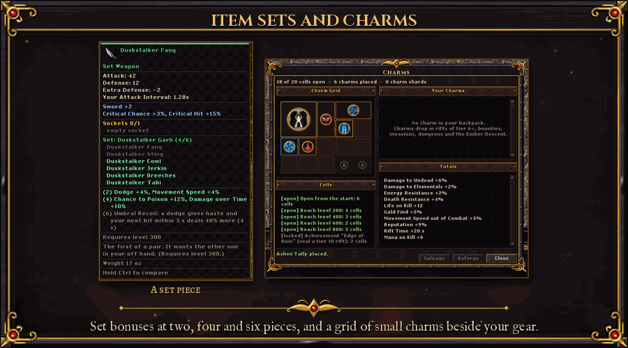

- **Ten item sets**, two for each kind of build (melee, ranged, caster, support, hybrid), with four to six pieces each.
  Bonuses come at two, four and six pieces, and every set has a signature effect at the top, such as *Hemorrhage*,
  *Red Harvest*, *Hanging Verdict* or *Umbral Recoil* (a dodge gives haste and makes your next hit stronger).
- **How pieces count:** a two-handed piece counts twice, a duplicate once, and a piece counts from its level on. The
  tooltip shows which pieces you wear, the Codex has a Sets tab, and Character Info lists your active bonuses.
- **Where they drop:** world bosses, monsters, rift chests by theme, the raid, the Ember Descent and dungeon clears.
  Set pieces you don't need salvage for rune shards.
- **Charms** (Character > Charms): a grid of 5 by 4 cells beside your gear, for small charms of 1x1, 1x2, 2x1 and 2x2.
  Six cells are open from the start; more open at levels 200, 400, 600 and 800 and with the *Edge of Ruin* achievement.
- **Charm bonuses** are small and focused: damage to one monster family, one element's resistance, life on kill, gold
  and orb find, speed out of combat, reputation or rift time. Bigger charms roll stronger, but no charm reaches the
  best roll of a gear slot. Four unique charms have a signature of their own.
- Charms drop in rifts of tier 6 and up, from bounties, invasions, dungeons and Ember Descent rooms. Salvage them into
  charm shards, or reforge one with shards.

## Crafting

> *"Every orb is a splinter of the break. Press it to steel, and the steel forgets what it was."*
> (from the Chronicle of the Broken World)

Orbs reshape your gear and your Rift Keys. Use them like any other tool: **"Use with" on the orb, then click the item**
in your backpack. No bench needed. The **Crafting Bench** (Economy > Crafting Bench) is there when you want to see an
item's modifiers, pick a modifier for the aimed orbs and preview what each orb would do before you use it.

| Orb | On gear | On a Rift Key |
|---|---|---|
| Orb of Awakening | a normal item becomes Common or Uncommon | a key without modifiers gets one |
| Orb of Gilding | a normal item becomes Rare, Epic or Legendary | a key without modifiers gets two or three |
| Orb of Grafting | adds one modifier on an open prefix or suffix, its tier by the item level | adds one modifier, up to three |
| Orb of Unmaking | removes one random modifier | removes one random modifier |
| Orb of Erasure | turns the item back into a normal item | removes every modifier |
| Orb of Upheaval | rerolls every modifier, same rarity and item level | rerolls the key's modifiers |
| Orb of Fate | rerolls the item with a new random rarity (same item level) | rerolls the values of the key's modifiers |

**Aim, bind and gamble** (the second set of orbs):

| Orb | What it does |
|---|---|
| Orb of Tempering | rolls the values of every modifier that is not bound again, inside their tiers (also on a Rift Key) |
| Orb of Binding | **binds** one modifier you pick on the bench: the other orbs leave it alone (1 per item, 2 from Legendary). Only an Orb of Erasure frees it |
| Orb of Excision | removes the **one modifier you pick** (a Rift Key: one modifier) |
| Orb of Reforging | rolls the tier and the value of the one modifier you pick again |
| Orb of Ruin | a gamble on an item with modifiers: 40% it improves (one tier more on every modifier that is not bound, or an extra modifier), 45% nothing, 15% it is **ruined**: no orb changes it any more (you can still wear and sell it). Never sold in the store |
| Whetstone | +1% **quality**: every modifier value is multiplied by it, up to 20% (30% from Divine rarity) |

On the bench, click a modifier to pick it, then press Use on an orb that takes a modifier; used directly with "Use with",
those orbs pick a modifier at random. A Rift Key's modifiers make the rift harder and its rewards better, so crafting a
key is how you push for more loot. Orbs drop from monsters (more from tiered ones and bosses), from bounties, rifts and
the weekly chest, and can be made from rune shards (Salvage). The store sells only Whetstones, the Orb of Excision and
the Orb of Binding, with weekly limits; no orb with a random result is sold. Uniques can't be crafted, so they stay unique.

### Crafting tables

The crafting hall has tables for seven crafts: herbalist, woodcutting, mining, general crafting, armorsmith,
weaponsmith and jewelsmith (Economy > Crafting Tables tells you where). Use a table and the **Crafting Table window**
opens on its craft:
- **Every recipe at a glance:** a tab per craft, a search over recipes and materials, and a *Can craft* filter. Each
  recipe shows the skill it needs against yours, its gold, and every material as have/need in green or red. Hover the
  result for its full tooltip.
- **Craft one or many:** Craft x N keeps going until it is done or something runs out, with a bar for each craft and
  the answer in the window. You need to stay at the table.
- **Crafted gear can roll a rarity**, from Common up to Legendary, with an item level and modifiers like a drop. The
  higher your skill above the recipe's level, the better the odds (up to 35% for any rarity) and the higher the item
  level (up to 90). A crafted piece never beats a boss drop.
- **Potions by skill:** potion recipes can give 50% more, or even twice as many, the more your skill is above the
  recipe's level. The cost stays the same.
- The window shows the odds before you craft, and names the rarity or the bonus when you get one.

### Gems and sockets

Gear can have up to three **sockets**: more on two-handed weapons and body armour, more at higher rarities. They drop
on rarity gear, and the **Orb of Sockets** rolls a new number for any piece. **Gems** come in seven kinds and five
qualities (Chipped, Flawed, Polished, Flawless, Perfect). Each gem does something different in a weapon, in armour and
in jewellery:

| Gem | Weapon | Armour | Jewellery |
|---|---|---|---|
| Ruby | fire damage | max health | fire resistance |
| Sapphire | ice damage | max mana | ice resistance |
| Emerald | earth damage | movement speed | earth resistance |
| Amethyst | critical hits | death resistance | death damage |
| Topaz | attack speed | energy resistance | energy damage |
| Diamond | holy damage | all elemental resistances | holy resistance |
| Onyx | life leech | physical resistance | physical damage |

"Use with" a gem on your gear to socket it, or on a gem of the same kind to turn three into one of the next quality.
At the Crafting Bench you can take a gem out for gold, or shatter it for free. Gems drop from monsters (better ones from
higher levels, elites and bosses), and come from bounties, rift chests and world bosses.

### Salvage

Gear you will never wear is not just vendor trash. The **Salvage** tab of the Crafting Bench (Economy > Salvage) breaks an
item with a rarity into **Rune Shards** (more for higher rarities and item levels, one more per T6-or-better modifier
and per empty socket) with a small chance of a whole orb, and turns shards into orbs: 12 for an Orb of Awakening, 25 for an
Orb of Upheaval, up to 100 for an Orb of Grafting and 150 for an Orb of Ruin. Salvage one item, or a whole bag up to the
rarity you choose (50 items at a time, after a confirmation). **Lock** the pieces you want to keep on the bench: salvage
and the Auto Seller never touch a locked item. Uniques and items with gems in their sockets are never salvaged.

### The Codex

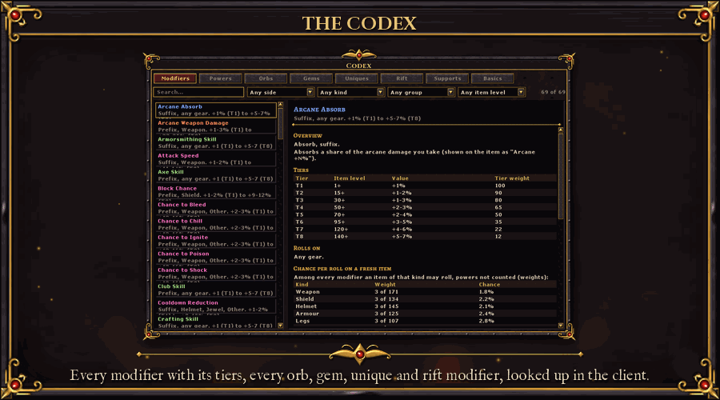

**The Codex** (Economy > Codex, or **Alt+K**) looks up the whole item system in the client: every modifier with its
tiers T1-T8, value ranges, the item level each tier needs and what it rolls on, the legendary powers, every orb and
where it comes from, gems, uniques and where they drop, rift modifiers and spell supports, plus a short "How items
work". Search by name or stat, filter by prefix or suffix, item kind and item level. Right-click a modifier on the
Crafting Bench to open its page.

## Monsters

> *"It was a wolf this morning. Then the ash settled on it, and now it burns."*
> (a hunter of the deep hunting grounds)

- **Monster tiers:** every spawn can roll **Magic, Rare or Legendary**, each tougher and better rewarded, with a higher
  item level on its drops. Tiered monsters and bosses roll modifiers: *Blazing, Chilling, Venomous, Shocking, Vampiric,
  Berserker, Brutal, Stoneskin, Reflective, Regenerating, Swift, Explosive* and *Juggernaut*. A tiered monster glows in the
  colour of its strongest modifier, and the monster bar shows its tier and modifiers.
- **Ember Blessings:** a kill may bless you for one minute: more experience, gold, damage, Chaos loot, rarity find or
  orbs, less damage taken, speed, regeneration or critical hits. Tougher monsters bless more often, trivial ones never.
  You hold at most three kinds at once, the same kind never stacks, and a second proc refreshes it. Not in PvP places.
- **Ambushes:** killing a monster can call a tiered copy of it out of the ash, right next to the corpse.
- **Treasure goblins:** a very rare, cowardly goblin that flees, blinks away and taunts you, then escapes 18 seconds
  after the first hit. Catch it in time for a hoard of gold, orbs and rarity gear.
- **Late game:** 17 level-scaled Chaos monsters (levels 650 to 1000) live in the deepest hunting grounds: Nightglass Core,
  Jaded Roots, Gloom Pillars and the Putrefactory. Experience stages are tuned so the road to 1000 stays rewarding.
- **New factions:** the **Goblin Tribe** (grunts, archers, bombers, witches, wolf riders, a hobgoblin captain and the
  Goblin Chieftain) and the **Wildwood Uprising** (wolves, boars, mushroom folk, dryads, owlbears, giant beetles and
  spiders, the Mushroom King and the Ancient Treant). They drop creature products to sell and food to eat.
- **Room to hunt:** the hunting grounds were filled out for a full server. Spawns that never came back now do, 184 new
  spawns fill 21 thin areas, the level 300-600 grounds refill in 90 seconds, and a pack refills in one or two checks
  instead of one monster at a time.
- **Dynamic respawn:** where several players hunt together, monsters come back faster: 85% of the normal time with two
  hunters, 70% with three, 55% with four and 50% with five or more. Characters on one IP count once.

## Endgame

> *"Five came through the first wound. Whenever the portals open at the temples, they come back, and never weaker."*
> (from the Chronicle of the Broken World, the Book of the Five)

### World bosses

Four times a day a portal opens at every temple and one of five colossal bosses waits behind it:
Kaelgor the Infernal Warlord, Skaldra the Rime Queen, the Rotmother, Nyxareth the Void Archon and Vharok the Blood Colossus.

- Each has phases, adds and 15 to 24 million health. It is built for a server, not a party.
- Everyone who takes real part gets a reward, not only the last hit: damage on the boss, healing other players and
  tanking the boss's blows all count, so a healer or a tank is rewarded like a damage dealer.
- The top 3 in damage, in healing and in tanking get extra orbs, a better chance at a boss unique and a title for a week:
  Bossbreaker, Lifewarden or Bulwark.
- Your first kill of each one gives a passive point.

### Rifts

> *"Turn the key and the wall forgets it was a wall."*
> (a Riftwalker)

Use a **Rift Key** (Adventure > Rifts) to open a 10-minute instance for you and up to 4 party members.

- **Keys** have a tier (1 to 15) and 1 to 3 modifiers that make the rift harder and its rewards better (item quantity,
  rarity and experience). Some are plain danger: *Vitality, Brutality, Haste, Elites, Reflection, Warding, Withering,
  Swarm, Teeming, Warbands, Twin Guardians, Cinderdeath, Blighted Mending, Waning Veil, Dread Guardian* and *Fragile*.
  Some are pure boons, shown in gold: *Gilded Trail* (a treasure goblin), *Sealed Coffer* (a guarded chest) and
  *Echoing Spoils* (copied loot). Modifiers roll in tiers I to V; higher keys roll the higher tiers.
- **The run:** clear the packs and the **Guardian** appears. Kill it in time to seal the rift, and its chest pays gold,
  orbs, gems, support runes and gear for every finisher. A sealed rift can drop the next tier's key.
- **Lives:** a run has shared lives (3, plus one for every extra player). A death costs one; the last one collapses the rift.
- **Omens:** sealed rifts of tier 6 and above give **Omen Fragments**. Sixty of them bind an **Omen Key**, which opens the
  arena of one of three Omen guardians for players of level 800 and above: Sangrith the Bloodmoon Herald, Morvane the
  Hollow Crown and Thalcyra the Stormbound Seer. Their chests are the richest in the game, with two unique rolls each.
- **Rift monsters** wear their rift's look and a name of their own by theme and rank, from *Abyssal Spawn* up to
  *Abyssal Sovereign*, on the monster bar and in the loot feed.
- **Bring a party.** Rifts and Omen arenas scale with the players who enter, up to 5. Each extra player adds 100% to
  the monsters' and the guardian's health and 10% to their damage. In return every finisher gets the whole chest plus
  12.5% per extra player (+50% for a party of 5) and kill loot rises 5% per extra player (up to +20%). A party clears
  about as fast as one player and earns more per head. The run tells you the numbers when it starts.
- A server restart or a crash never eats your key.

### The Rift Atlas

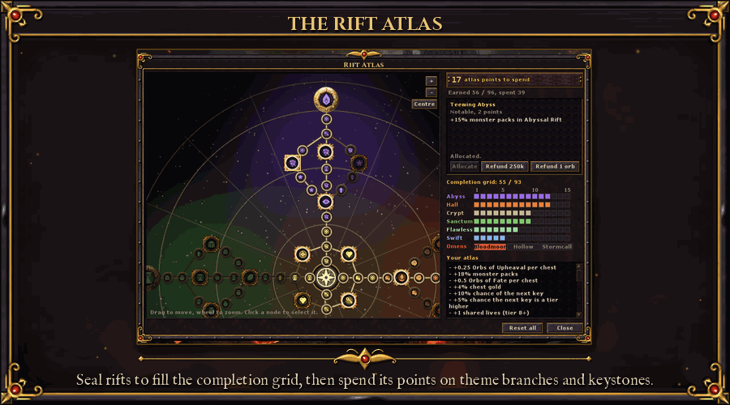

Long-term rift progression (Adventure > Rift Atlas, or the rift HUD).
- **Completion grid:** every theme at every tier, plus flawless runs, swift runs and the Omens. Each new box pays atlas
  points, 96 in all.
- **The node map:** 81 nodes in theme branches from the Heart of the Atlas: more packs, more chest gold and orbs, a
  better chance at the next key, shared lives. Four keystones change how your rifts play; you hold one at a time.
  *Obsidian Crown*, for one, makes the guardian twice as strong and raises its chest's orbs by half.
- **Respec** a node for gold or an Orb of Upheaval. A full atlas is worth roughly a third more income per run.

### Ascended Omens and the Cinderheart

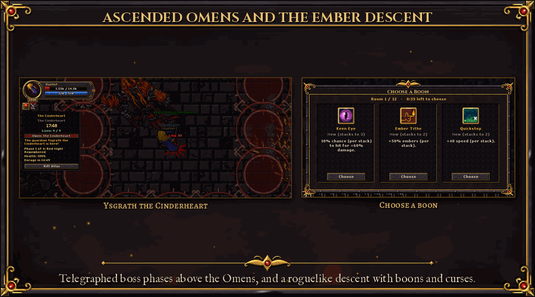

The top challenge, above the Omen Keys.
- **Ascended Shards** drop from Omen guardians and tier 13-15 rifts. Four bind an **Ascended Sigil**, which opens the
  Ascended form of Sangrith, Morvane or Thalcyra, alone or with up to 5 players. Like the rifts, each extra player
  adds 100% boss health and 10% damage, and 12.5% more spoils for every finisher (+50% for a party of 5), so a full
  party kills in the solo time and each player takes home more.
- **Real mechanics:** phases at health thresholds, telegraphed hits with two warning turns, adds, pools, storm columns,
  a creeping edge and an enrage at 10 minutes. Shared lives; the fallen come back through the Ember Gate.
- **Ysgrath the Cinderheart:** a relic from each Ascended guardian forges the Cinderheart Sigil. Four phases, an enrage
  at 15 minutes.
- **Rewards:** four Ascended uniques, nine achievements with titles, the Cinderheart Crown kill effect, and weekly
  fastest-kill boards per party size with a tab for every class.

### Infinity Tower

Climb floor after floor alone or with a party of up to 4 (Adventure > Infinity Tower), against the clock. Every floor is a
wave, every tenth a boss floor, and magic, rare and legendary monsters grow more common as you climb. Your best floor
counts on the tower ranking, with milestone rewards on the way, and the Tower Ascension days give double tower points.

### Dungeons

Instanced runs for a solo hero or a group, with a queue, a timer and a boss at the end. Six difficulties raise monster
health and damage, and pay back in experience, gold and extra loot. Speed and flawless challenges and solo and group
rankings keep score.

### The Ember Descent

A roguelike trial below the city (Adventure > Ember Descent, or the portal next to the temple), alone or with up to 4
players from level 100.
- **8 to 12 rooms** in a seeded chain: combat, elite, treasure, shrine and merchant rooms, and a boss in the last hall.
  Monsters grow stronger the deeper you go.
- **Boons** last for the run only: choose one of three after a room. Sixteen of them: damage, brands that turn physical
  damage into fire, ice or death, lifesteal, echo hits, wards, crits, execute, thorns, a second life and more. They sit
  on the buff bar.
- **Curses** are optional: take one for 15-25% more rewards. Spend embers at the merchant.
- **Rewards by depth:** gold, orbs, five uniques found only here, three titles, and set pieces.
- One free run a day and a free weekly seeded run with its own leaderboard. More runs take an Ember Sigil, forged from
  25 rune shards and 50,000 gold.

### The Ashen Sepulchre, the weekly raid

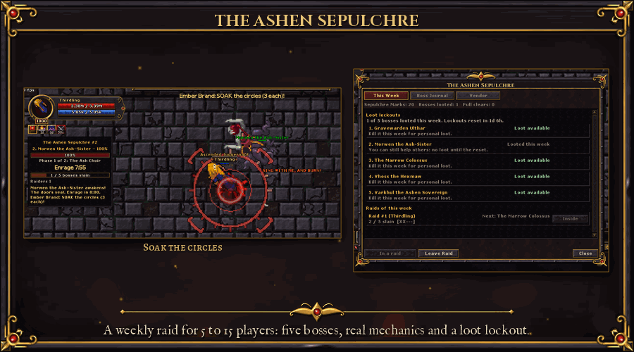

A raid for organised groups of 5 to 15 (Adventure > Raid: Ashen Sepulchre, or the portal next to the temple).
- **Five bosses in a row** with trash and doors between them: Gravewarden Ulthar, Morwen the Ash-Sister, the Marrow
  Colossus, Vhoss the Hexmaw and Varkhul the Ashen Sovereign, each with a look of its own.
- **Mechanics to learn:** tank swaps with stacking debuffs, a frontal cleave and a rear sweep, split soak circles,
  adds to kill first, spread marks, an effigy to break and a hex to cleanse. Phases and an enrage on every boss.
- **Weekly lockout** per character and boss: personal loot of gold, orbs, gear at item level 120-130 and a small chance
  at a raid unique, plus Sepulchre Marks for the weekly vendor. You can help after your lockout, without loot.
- A raid is saved by its raid ID, so a group can continue it later in the week. The Boss Journal tab explains each
  fight; a weekly fastest-clear board, nine achievements and a guild trophy keep score.

### Bounty board

Daily "kill X in Y" contracts per level band (Adventure > Bounty Board) that pay orbs, gems and support runes. Finish
seven in a week for the weekly bounty chest.

### Invasions and world events

- **Invasions** (Adventure > Events): a few times a week a horde of orcs, undead, demons or minotaurs falls on a town or a
  hunting ground. It comes in five waves and marches on the town's heart, and its warlord leads the last wave.
  - Everyone can defend. The bar at the top left shows the wave, the invaders left, the time and the **breach
    meter**, which fills while invaders stand at the target.
  - Hold it and everyone who fought is paid by their part in the defence: damage, kills, and healing for healers.
    The pay is gold, orbs and a chance at a unique, plus points on the weekly **Defender** leaderboard. The whole world
    gets +10% experience for an hour.
  - Lose it and the invaders occupy the place for 30 minutes. Slay the occupiers to free it for a smaller reward.
  - Warnings come 30, 10 and 1 minutes before. The calendar shows the fixed invasion days, but some invasions come
    unannounced.
- **World events** every few hours, somewhere in the world:
  - a *Chaos Storm*: three times as many magic, rare and legendary monsters for 15 minutes
  - a *Wandering Merchant* who sells orbs cheaply for 20 minutes; the town is announced, you have to find him
  - a *Golden Hour*: +25% loot in one area for 30 minutes
- **Events calendar:**
  - *Blood Moon* weekends: +50% experience
  - *Chaos Rift* Wednesdays: double tiered spawns
  - *Loot Frenzy* Fridays
  - *Tower Ascension* days twice a month: double Infinity Tower points
  - a daily boosted creature and boss
- **World buffs:** any player can light one from the store (more experience, loot or skill training for everybody, for an
  hour). The whole server sees who did.

### Community goals and the weekly world modifier

- **Fuel the Brazier** (Adventure > Community): one server-wide bar each week, fed by monster kills, sealed rifts,
  invasion waves, world bosses, crafting orbs and gold given to the Great Brazier next to the main temple. Daily caps
  per character keep it fair.
- **Stages** at 25, 50, 75 and 100% light buffs for everybody: +10% experience, +10% loot, a better Rift Key chance and
  more reputation. The top 3 contributors earn a title, everyone above 1,500 points some orbs.
- **A weekly world modifier** (one or two each week) changes the world for seven days: *Ember Tides*, *Champions' Week*,
  *Restless Dead*, *Gilded Week*, *Forgefire*, *Dragonfall*, *Ambush Season*, *Banner Week* or *Tower Echoes*.

### Boss Spawns

The Boss Spawns window (Adventure > Boss Spawns) lists about a hundred bosses in ten categories: world, island, raid,
lair, invasion, rift and Omen, dungeon, tower, trial and rare. It shows where each one lives, whether it is alive and
when it was last killed, the countdown to the next world boss, and your own cooldowns and raid lockouts.

## Factions and reputation

> *"Four banners still fly over the ash. Each wants your blade, and each remembers whom you served."*
> (a quartermaster of the Ashen Vigil)

Four factions want your help (Adventure > Factions, or their quartermasters): the **Ashen Vigil**, the **Cinderforge
Compact**, the **Veiled Choir** and the **Thornbound Circle**.
- **Ranks** from Hostile to Exalted. Reputation comes from daily and weekly contracts, from kills of the families they
  hunt, bounties, sealed rifts, invasions, world bosses and turned-in tokens. Daily gains taper off, and each week has
  a cap.
- **Rivals:** every gain lowers your standing with that faction's rival by a quarter of it, never below Wary. Choosing a
  side costs something, but both sides stay possible. Exalted takes about five weeks per faction.
- **Quartermasters** sell fixed gear (Epic, item level 100-125, tiers T5-T7), orb bundles for gold and recipes.
- **Looks of their own:** a tabard aura at Revered (Pyrelight Mantle, Forgeflame Ring, Veiled Eyes, Thornfire Wreath)
  and a mount at Exalted (Pyrewarden Charger, Forgeborn Emberwolf, Veilrunner, Thornbound Stag), plus rank titles with
  plate frames, Exalted achievements and a weekly Reputation board.

## Bestiary and kill tasks

> *"Write down what it eats, where it sleeps and what it fears. Then go and kill a thousand of them."*
> (the Chronicler, to a new hunter)

The bestiary (Hunt > Bestiary) has a page for every monster in the world, and it fills in as you hunt:
- **Stages:** your kills unlock each monster in four stages: **Discovered**, **Studied**, **Mastered** and **Completed**.
  How many kills each stage needs depends on how dangerous the monster is: a rat is done after 250, a dragon lord after
  1,000, a boss after 5 kills. Rare monsters that only live in a few places need fewer.
- **What you learn:** Discovered shows its picture, level, health and experience. Studied adds its weaknesses and
  immunities, where it lives and its rarest loot. Mastered shows its whole loot list and the Chaos uniques it can drop.
- **Completion bonus:** a completed monster takes 1-3% more damage from you and gives you 1-3% more experience.
- **Bestiary points and ranks:** every stage gives points, and so do kill tasks. Points raise your bestiary rank, from
  Novice to Monster Sage, and each rank adds a little experience from every monster (up to +3%).

**Kill tasks** (Hunt > Kill Tasks) are your own hunting orders:
- **The board** offers a few hunts and family tasks for your level every day ("kill 150 Hellspawn", "kill 270 dragons
  of level 85-189"). You can also take a hunt task from any monster you have discovered, if it suits your level.
- **Rewards:** gold to your bank, orbs, experience and bestiary points. You can hold 3 tasks at once and finish 4 a day
  and 20 a week. Kills by party members near you count too, and a kill counts for your tasks and the bounty board alike.

The **task tracker** at the bottom right of the screen lists your kill tasks and bounty contracts with their progress,
updated with every kill.

## Seasons

> *"The ash falls, the ladder is swept clean, and new names climb it. The ash remembers who reached the top."*
> (from the Chronicle of the Broken World, on the Season of Ash)

Start fresh with a **season character** (Adventure > Season, Join, on a new character) and race on the season ladder.
- **Own economy:** season characters trade, mail, party, loot, send bank gold and use the market only with their own season.
- **Season uniques:** some uniques drop only for season characters while the season runs, then for everyone.
- **Reward track:** outfits, addons, mounts and titles for milestones (level 100 / 300 / 600 / 1000, bounties, world
  bosses, rifts), unlocked for your whole account and kept forever.
- **Season end:** season characters join the normal world with everything they earned.

**Season modes** are picked when you join and kept until the season ends:
- **Self-Found:** no trading, market, Orb Exchange, mail, gold transfers or other players' drops; parties only with other
  Self-Found characters. In return +25% item find and rarity find.
- **Hardcore:** one death and the character has fallen. It moves to the normal world at once, and its grave goes on the
  Fallen tab with its level and cause. Disconnects, lag spikes and server restarts are guarded, so only a real death
  counts. Hardcore characters stay out of the Scorched Marches.
- **Both** at once, for the bravest. Each mode has its own leaderboard tab and achievements.

**Seasonal Journey** (the Journey tab of the Season window): eight chapters of season objectives, opened by level. Each
chapter pays pass XP, orbs and a piece of the *Ashen Pilgrim* set (six transmog looks, an outfit and a mount), with a
title at the end.

**Season pass** (Adventure > Season Pass): a free and a premium track of 50 tiers, earned by playing: experience, bosses,
bounties, rifts, goblins, invasions and daily and weekly challenges. The premium track holds cosmetics and potions.

## PvP

> *"The Obelisk does not care whose banner flies over it. It only counts the seconds you hold it."*
> (a Siege Champion)

- **Ranked arena** (Adventure > Arena): **1v1, 2v2 and 3v3** with a rating per mode.
  - Matchmaking pairs players of close rating and similar level.
  - Nobody really dies and there are no skulls: a lethal hit sends the loser to the gallery.
  - Each win pays an orb, and the first win of the day pays a bonus.
- **Battleground: Ember Wells** (Adventure > Battleground): 5v5 to 10v10. Take and hold three braziers; the first team to
  1000 points wins.
  - Teams are balanced by role (tank, healer, damage) and rating. Damage and healing are scaled to your level bracket.
  - The fallen come back with the next wave, and nothing is lost: no items, no experience. Deserters and idlers are
    held back from the queue.
  - **Honor** from matches and a weekly first win buys cosmetics and potions at the honor vendor.
- **PvP seasons** of eight weeks for 1v1, 2v2, 3v3 and the battleground. Five placement matches, then tiers from
  *Ashen* to *Cinder Sovereign*, a soft reset each season and decay at the top. The best tier you reach pays titles,
  plate frames and cosmetics at the season's end.
- **Guild Siege** (Adventure > Guild Siege): every Saturday at 20:00, up to four guilds per arena fight over the
  **Chaos Obelisk**.
  - You score by striking enemies down and by holding the obelisk. Nobody really dies.
  - The winners become **Siege Champions** for a week: a title and +5% experience.

### The Scorched Marches

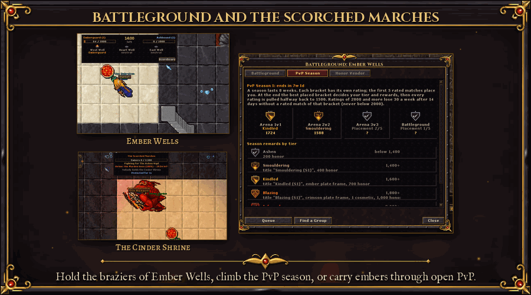

An open PvP zone for level 150 and up (Adventure > Scorched Marches), entered from a protection zone after you accept
its rules.
- **Everyone can attack you**, whatever the world's rules, but there are no skulls or frags, and a defeat throws you out
  instead of killing you. Your gear and experience are safe.
- **Embers** are the stake. Monsters here are stronger and pay more, and you carry the embers you earn (up to 2,500).
  A defeat drops them as a pile your killer can take. Bank them only at a safe exit after a short channel.
- **Fair fights:** the same anti-farming rules as guild wars (account, IP, level gap, fresh arrivals, repeat victims).
- **Pledge** to a faction to earn reputation for rival defeats.
- **The Cinder Shrine** every two hours: slay its warden and hold the circle, and your faction gets +10% experience and
  loot for an hour.
- An ember vendor, a weekly board and six achievements.

## Guilds and guild halls

> *"A banner is only cloth. A hall is where the guild remembers its dead and counts its gold."*
> (a guild steward)

Your guild grows with you. Open the **Guild** window (Social > Guild) to see its level, your members and
what everyone has contributed this week.
- **Guild levels (1-20):** the guild earns guild XP from what its members already do: a small share of your hunting
  experience (capped each day), bounty contracts, sealed rifts, world bosses, defended invasions and the guild siege.
- **Perks for online members**, small but always on: up to +5% experience and +5% loot, cheaper respecs, a free guild
  hall scroll every day, more guild depot space and a guild aura.
- **Guild bank:** every member can deposit gold; the leader can withdraw it. Every movement is logged.
- **The guild hall** (from guild level 5): the leader buys it, and members step through the portal next to the temple
  to reach it. Nobody else gets in.
- **Hall upgrades:** a teleport hub to the hunting grounds, a training room with exercise dummies, a crafting bench,
  a **guild depot** shared by the members (with a log of who put in and took out what), a trophy room with your siege
  wins, world boss victories and records, and three decoration tiers.
- **Rent:** the hall costs a weekly rent from the guild bank. If the bank runs dry the upgrades lock until it is paid;
  nothing is ever lost.
- **Top guilds:** the Guild window's weekly board of the guilds that earned the most guild XP.

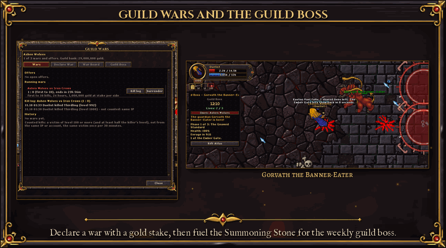

- **Guild wars** (Social > Guild Wars): the leader declares a war in game with a frag limit, a duration and an optional
  gold stake from the guild bank. The other guild accepts or declines within 24 hours. The stakes are held until the
  end; the winner takes both, minus 10%.
  - War emblems over every member, a live score and a kill log. A war ends at the frag limit, at the time limit or by
    surrender.
  - Only fair kills count: not from the same IP or account, not on low-level victims, not the same victim twice in 30
    minutes. The war board is in the game and on the website.
- **The weekly guild boss:** members fuel the **Summoning Stone** in the guild hall with gold and materials. When it is
  full the leader summons **Gorvath the Banner-Eater**: telegraphed attacks, phases, adds and shared lives, scaled to
  the members in the fight. One kill per guild and week pays a guild gold pool split by damage and healing, orbs for
  everyone, guild XP and a guild banner that grows with every kill. A weekly board ranks the fastest guilds.

## Leaderboards and titles

> *"Every Monday the stone is wiped and the names are carved anew. Only the titles linger, for one week."*
> (from the Chronicle of the Broken World)

Weekly boards (Social > Leaderboards) reset every Monday:
- World Boss damage, Boss Healer and Boss Tank
- Bounty Hunter
- Rifts
- Goblin Slayer
- Guild Siege
- Arena 1v1 and 2v2
- Defender (invasions defended)
- Cinderheart fastest kills (alone, 2-3 and 4-5 players, with class tabs, also on the website)
- Reputation
- Gatherers (materials gathered; a title only)

Other systems keep weekly boards of their own: the raid's fastest clear, the Ember Descent's weekly run, the guild boss,
the battleground and the Scorched Marches. Season modes get their own tabs, Hardcore graves included.

The top 3 of each board earn a **title** for the next week (Bossbane, Warden of the Hunt, Riftwalker, Goblin Slayer,
Siegebreaker, Duelist, Gladiator, Defender of the Realm) and orbs. The all-time **Class Ladder** ranks the highest
characters of every class.

**Name plates.** Above every player floats a name plate: their **title** on top, their **guild** in braces below it, and
their **name** on a small framed plate. Titles come from the leaderboards (gold), the guild siege (Siege Champions, orange,
with a crimson plate), the ascension, seasons, login streaks and achievements; staff wear red titles on a gold plate. Hold
several? Pick one, or none, in the Achievements window (Character > Achievements).

## Achievements

> *"I write down every deed. A few of them I may not write down until someone has done them."*
> (the Chronicler)

Over 150 achievements (Character > Achievements) give you goals in every corner of the game:
- **What counts:** levels and Paragon, magic, rare and legendary kills, ambushes, Treasure Goblins, each world boss, rift
  tiers, modifiers and Omens, the Ascended bosses, the raid, the Ember Descent, factions, professions, bounty contracts and weekly
  chests, uniques and rarities found, orbs used, arena wins and ratings, guild sieges, the battleground and the
  Scorched Marches, Hardcore and Self-Found seasons, and a few secrets that stay hidden as **???** until you find them.
- **Reward track:** your account's points unlock cosmetics at seven milestones (100 to 3,500 points), and completing a
  whole category unlocks one more, with a title and a plate frame. Kill effects, loot label accents and chat colours
  that are never sold. A bar with milestone pips shows what comes next.
- **Points:** every achievement is worth points. Your account total counts each achievement once, whichever character
  earned it.
- **Rewards:** many give a title; some pay orbs, others an outfit with its addons, a mount, a pet or a portal style.
  Some unlock wardrobe exclusives that are never sold (see Cosmetics and the wardrobe).
- **Already a veteran?** Levels, Paragon, ascension, bounties and arena results you had before are counted the next time
  you log in. A toast pops up the moment you unlock one, with its reward on it.

## Pets

> *"It will not fight for you. It will not die for you. It will, however, steal from the dead on your behalf."*
> (a pet trader in the lower city)

A pet is a small companion that walks at your side (Character > Pets). It cannot fight and cannot be hurt, and
only one is out at a time.
- **Getting one:** whelps drop very rarely from dragons and frost dragons, the Duskwing from any monster worth your time
  (more often from magic, rare and legendary ones), the Lantern Wisp, the Hoarder Squirrel and more are in the store
  (Pets), and the Ash Cat, the Gilded Goblin and the Riftling come with achievements. Two are rare boss drops that are
  never sold: the Rotling from the Rotmother and the Ashweaver Spiderling from the Sepulchre's wardens. Finding a pet
  you already have gives yours experience instead.
- **Levels:** your pet levels with your kills, up to level 50.
- **Abilities:** every species has two small ones, the second from level 20: **Mend** (heals you when you drop below half
  health), **Ward** (less damage from monsters for a few seconds when you are hurt), **Spark Aura** (hits the monsters
  next to it that are after you), **Gold Sniffer** (more gold in your kills), **Treasure Sense** (more item find) and
  **Fetch** (carries the gold of your kills straight to your bank).
- **Where:** pets wait outside protection zones and stay home from the arena, the siege and PvP zones. In rifts, the
  Infinity Tower, dungeons and the world boss arena only the gold, item find and fetch abilities work.

## Hideouts

> *"Every hunter needs a place where the ash does not fall. Fill it with what you took from the dark."*
> (a hideout warden)

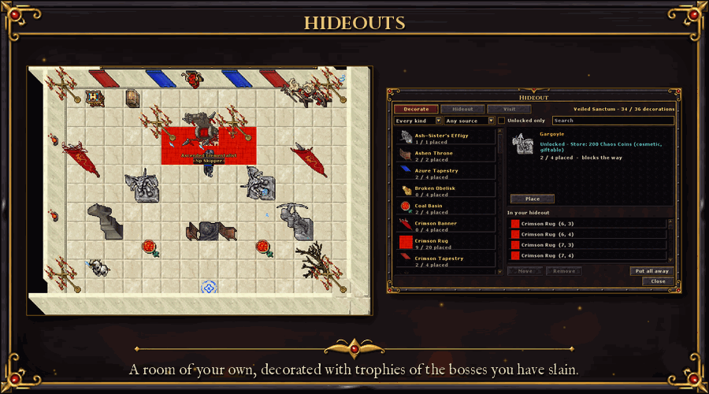

A room of your own (Character > Hideout), built when you enter it.
- **Four themes:** Ashen Crypt, Ember Forge, Veiled Sanctum and Thornbound Grove.
- **Over 50 decorations**, placed on a grid and rotated freely. They come from achievements, faction ranks, the bosses
  you have slain (the raid, the Ascended Omens, the Cinderheart, world bosses), the Ember Descent, events, season
  journey chapters and the store.
- **Useful too:** your depot, the stash and exercise dummies, but no buffs.
- **Visits:** keep it private or open it to friends, your guild or everyone. Visitors can like it, and the best rooms
  go on a showcase.

## Professions

> *"The ash grows things too. Bitter things, mostly. The Broker pays for bitter."*
> (a herbwife of the lower city)

Four gathering professions (Economy > Professions), each with its own level from 1 to 100 per character:

| Profession | Gathers | Tool |
|---|---|---|
| Delving | ore veins | a pick |
| Wortcunning | herb patches | a sickle |
| Flaying | fresh corpses of beasts and reptiles | an obsidian knife |
| Angling | fish and pearls, on any fishing cast | a fishing rod |

- **Gathering** is a short channel on the cast bar. Moving, attacking or taking damage breaks it. Veins and herb
  patches stand in eight hunting areas, and each one is yours again 6 minutes after you gather it, so nobody can
  steal or camp a node. Flay your own kills or your party's, once per corpse.
- **Five tiers of materials,** from Common to Infernal, each opened by your profession level and your character level.
  The Professions window lists where to gather each tier and which of your nodes are ready.
- **The Material Broker** next to every temple buys them all and pays into your bank. Demand changes every week: each
  profession's five materials pay x1.5, x1.25, x1, x1 and x0.75, in a new order. Per material and day the first 100
  pay in full and the next 100 pay half. At best, gathering earns about a quarter of what hunting at the same level
  pays, less at the top tier.
- **The real prize is experience:** all your profession levels together give up to **+10% experience from monsters**,
  shown on the buff bar. Every profession at 100 reaches the cap.
- Professions make no gear and no orbs. They have their own achievements and titles (Master Delver, Master Angler,
  Master of the Wilds ...), a weekly Gatherers board and a Materials tab in the Codex.

## The market

> *"Everything has a price in the broken world. Even the things that glow."*
> (a broker of the lower city)

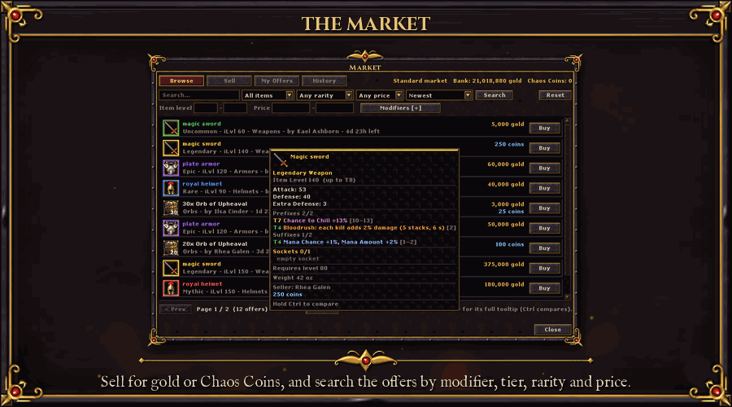

Sell and buy with other players at **Economy > Market** (Alt+E), or by using the market in any depot.
- **Gold or Chaos Coins:** put a price in gold, in Chaos Coins or both; the buyer picks. Gold is paid from and to the
  bank, coins from and to your account.
- **Any item:** orbs and other stacks (sell part of a stack) and rolled gear with every modifier, tier, socket, gem,
  quality and legendary power exactly as it is.
- **Browse:** search by name, filter by category, rarity, item level, currency and price, sort, and hover an offer for
  its full tooltip (Ctrl compares with what you wear).
- **Modifier search:** add up to 6 rows, each a modifier or legendary power with the lowest value and the lowest tier
  ("T5+" finds T5 to T8). Ask for all rows or for some of them, and for sockets, quality, a free prefix or suffix slot, a
  legendary power or a bound modifier.
- **Buy orders:** ask for what you cannot find: an item, how many, the lowest rarity, item level or modifiers (the same
  search as above) and your price per item in gold or Chaos Coins. The money is held when you post; sellers fill the
  order from their backpack, all at once or a few at a time, and what is not bought comes back when it ends.
- **Fees:** listing 1% of the gold price (at least 100 gold, not refunded), 5% sales tax when it sells. Offers last 1, 3
  or 7 days; up to 20 offers and buy orders at a time. What does not sell comes back to your inbox. Buy orders pay the
  same fee on their total.
- **Safe:** bought and returned items arrive in your inbox. Every sale and every filled buy order pops an *Item sold*
  toast with the item, the count, the price, the fee and what you got. Sold while you were away? One summary waits for
  you at login. A server crash in the middle of a purchase loses nothing.
- **Price history:** every sale is recorded by item kind, rarity and item level. See the last sale, the 7-day median,
  the range, the volume and a 30-day chart. Browse marks offers well under or over the typical price, and the Sell form
  suggests a price and warns you when yours is far off.

### The Orb Exchange

A currency order book for the crafting orbs (Economy > Orb Exchange, or the button in the Market window).
- **Trade orb for orb or orb for gold** with limit orders: give so many of one, want at least so many of another.
  Orders fill at the best price, in part or in full; what is left comes back when you cancel or the order ends.
- **The book** shows its depth, the last trades, 24-hour volume, high and low, and an hourly price chart.
- A small fee on gold trades and per orb-for-orb order keeps gold leaving the game. Season books are kept apart.
- A filled order pops a toast too, also while you were away.

## The Gambler

> *"You see the make and the craft, never the luck inside. That you pay to learn."*
> (Mordecai Ashwager, the Gambler)

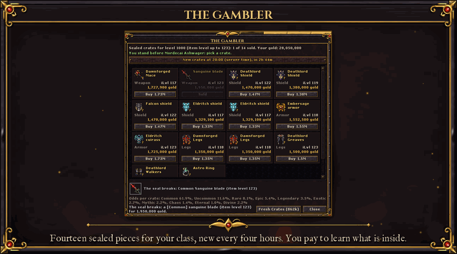

Mordecai Ashwager stands next to the temple of Mirewake, the main town, and sells **sealed equipment for gold**
(talk to him, or Economy > The Gambler).
- **Your own stock:** 14 sealed pieces made for your character: gear your class can use, at an item level close to
  what your own kills drop. You see the base, the slot and the item level. The rarity stays hidden until you pay.
- **New crates every 4 hours,** at 00:00, 04:00, 08:00, 12:00, 16:00 and 20:00 server time, with a countdown in the
  window. Your stock stays the same through relogs and restarts.
- **The odds are on the window:** never plain, at least as good as a magic monster's gear drop at every rarity up to
  Divine, and Legendary or better about one crate in eight. The rarities above Divine stay with the monsters.
- **Prices** follow your level: an armour piece costs about 18% of an hour of hunting. *Fresh Crates* gives you a new
  stock at once for half an armour piece, doubling each time, three times per window.
- A Divine reveal is told to everyone nearby. Bow classes can find quivers in the crates.

## Depot tabs

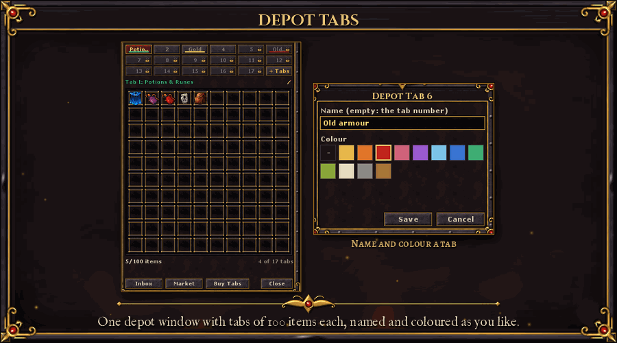

Your depot is a tabbed stash. Use a locker and **one depot window** opens: the tab buttons, the active tab's 100 slots,
the item count, and buttons for the Inbox, the Market and Buy Tabs.
- **4 tabs free**, 100 items each. A container counts as itself plus everything in it.
- **More tabs:** +1 while the Chaos Pact runs, up to 9 more from the store (150 Chaos Coins each, or 500 for 4), and
  one each for three achievements (Cabinet of Curiosities, Hall of Trophies, Keeper of the Vault). 17 at most.
- **Name and colour each tab:** right-click a tab to give it a name of up to 16 characters and one of 12 colours. Every
  character on your account sees the same names.
- **Nothing is ever lost:** a tab above your count is withdraw-only, and items above a limit stay where they are. Your
  old depot was sorted into tabs the first time you opened it. Each town keeps its own depot; your tab count is the
  same in all of them.

## The store and the pouches

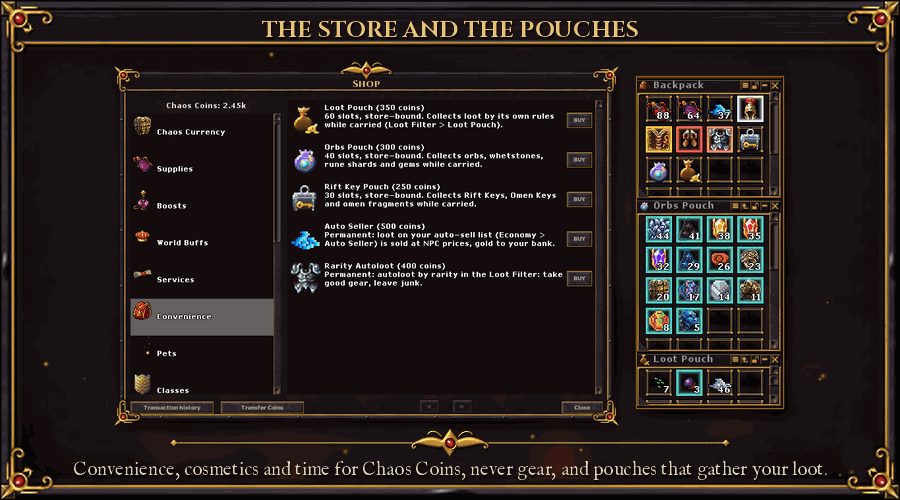

The store (Economy > Store) is paid in **Chaos Coins**. It sells convenience, cosmetics and time, and **no gear**.
- **Classes:** the Necromancer, the Monk and the Templar, for your whole account.
- **Store pouches:** a **Loot Pouch** with its own autoloot rules, an **Orbs Pouch** (orbs, rune shards and gems) and a
  **Rift Key Pouch** (Rift Keys, Omen Keys and fragments). They collect their loot from your kills while you carry them.
  One of each per character; they cannot be traded or dropped and come back after a death.
- **Convenience:** Auto Seller (sells the junk from your kills straight to your bank), Rarity Autoloot.
- **Boosts and world buffs:** stamina refill, double experience potions, blessings, and the server-wide experience, loot
  and training buffs.
- **Services:** name, class and sex change, frag and skull removal, a passive tree and Paragon reset.
- **Depot tabs:** 150 Chaos Coins for one, 500 for four (see Depot tabs).
- **Cosmetics:** outfits, mounts, wings, auras, outfit shaders, portal styles, pets, hideout decorations, spell effect
  skins, kill effects, loot label accents, chat name colours, plate frames, footprints and outlines. Unlocks are
  account-wide. Items and hideout decorations can be sent as a gift.
- **Transmog sets:** appearance only (see Cosmetics and the wardrobe).
- **Chaos Pact:** a 30-day subscription that raises the free limits while it runs: stash tabs, depot tabs, market
  listings, saved builds, loot rules and character slots. When it ends nothing is deleted; extras just become read-only.
- **Crafting supplies with weekly limits:** Whetstones, the Orb of Excision and the Orb of Binding. No orb with a random
  result is sold (no Upheaval, Fate, Gilding, Awakening, Erasure, Unmaking, Grafting, Sockets, Tempering, Reforging or Ruin).
- **Training weapons.**

**Donations.** Chaos Coins are a thank-you for a voluntary donation: nobody is required to donate, and the game is fully
playable for free. Donations go through the Store's Donate button or the website, with Pix or PayPal, and are confirmed
automatically.

**Coin gifts.** You can send Chaos Coins to another account, up to 5,000 a day, but not in the 14 days after your last
coin order. A charged-back order takes its gifted coins back.

**Referrals** (Character > Referral): give a friend your code. They get a welcome gift, and you get cosmetic titles and a
few Chaos Coins when they reach levels 50 and 150.

## Cosmetics and the wardrobe

> *"Steel is borrowed from the dead. A look is yours until the ash takes you."*
> (a tailor of the lower city)

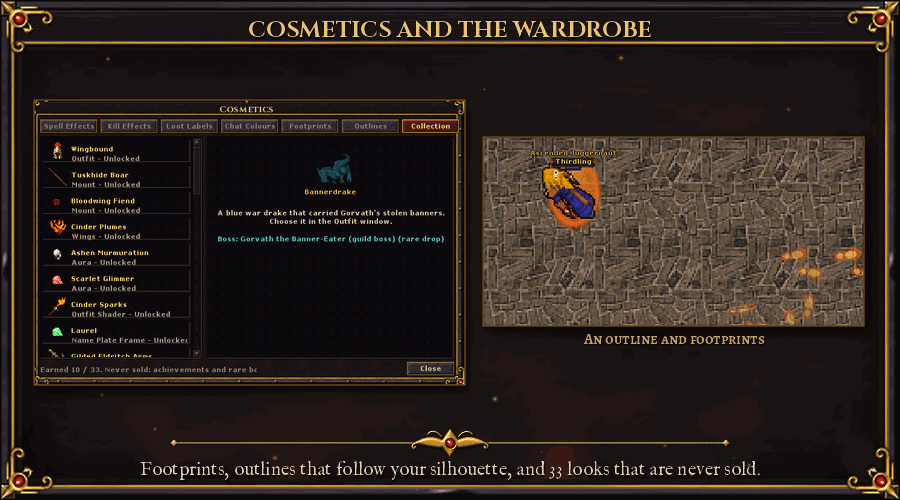

Choose what your character shows in **Character > Cosmetics**: spell effects, kill effects, loot labels, chat colours,
footprints, outlines and the Collection. Everything is looks only and unlocks for your whole account.
- **Footprints:** glowing prints on the tiles you leave behind, fading in about three seconds. Embers, frost, blood,
  petals, storm sparks and more.
- **Outlines:** a thin line that follows your character's silhouette, mount and addons included. One colour or a
  gradient, and some of them pulse.
- **Everyone sees them,** and you can hide other players' footprints and outlines in the same window.
- **In the store:** 9 footprints, 9 outlines, name plate frames, transmog sets and pets, besides the outfits, mounts,
  wings, auras and effects that were there before.
- **33 exclusives that are never sold.** Every kind of look has some that only an achievement or a rare boss drop
  gives: outfits and addons, mounts, wings, auras, outfit shaders, plate frames, portal styles, transmog sets, pets,
  footprints and outlines. Boss drops are personal: every player who earns a world boss, raid, Ascended, Cinderheart
  or guild boss reward rolls for one of their own, and it unlocks straight for the account. They cannot be traded.
- **The Collection tab** lists every exclusive, owned or not, with where it comes from and a preview on your own
  character.
- **Transmog** (Character > Transmog): give your gear the look of any item of its kind you have unlocked, in an
  account-wide wardrobe with appearance sets.

## Quality of life

> *"Count your kills, count your coin, and come back tomorrow. The Chaos is patient. So are its rewards."*
> (from the Chronicle of the Broken World)

- **Town Portal:** every character has it from the start, with unlimited uses. Cast it from the action bar (the spell
  Town Portal, `ash domh`) or from Character > Town Portal. After a 3 second channel a portal opens beside you that leads
  to your town's temple, and a return portal at the temple brings you back to the exact spot. You and your party members
  can use it for 5 minutes; 60 second cooldown. It does not work in protection zones, after PvP, with a skull, or inside
  arenas, sieges, rifts, dungeons and the tower, which have their own exits.
- **Portal Style** (Character > Portal Style): pick the look of your portal and its opening and closing effects; everybody
  sees it. Six styles are sold in the store and six are earned only through achievements.
- **Hunt tracker** (Hunt > Hunt Tracker): experience, loot, supplies and profit per hour for your session, counted by the
  server. It also shows kills per monster, every item looted and its value, damage and healing per second, and your
  Chaos drops. Pause, reset or copy a summary.
- **DPS meter and combat log** (Hunt > DPS Meter, or the Meter button of the Hunt Tracker): damage, healing and damage
  taken per spell, rune, weapon attack, damage over time, proc and summon, for each fight (bosses named), the last ten
  fights and the session. The Combat Log window adds hits, crits, averages and elements. Party mode shows everyone's
  DPS and HPS (you can opt out); export a summary to the clipboard or chat.
- **Party Finder** (Social > Party Finder): post a group for a rift tier, a dungeon, a world boss, an Omen, the Infinity
  Tower, the raid, a trial or anything else, and say which roles you want (tank, healer, damage) and the minimum level.
  Others browse, filter and apply with a role, or queue with "Join as". Accepting sends a real party invite. Raid
  listings hold 15 players (up to 3 tanks, 4 healers and 12 damage dealers). Mentors can tag their groups.
- **Map overlay:** press **Tab** to lay a see-through map over the game view, centred on your character, with icons for
  your party, the temple, depots and NPCs, rift exits and guardians, treasure goblins, world bosses and invasions. Zoom,
  pan and change the opacity while you keep playing. Inside a rift the layout fills in as you explore it.
- **Daily rewards and login streaks:** one claim a day per account. Milestones at 7, 14, 30, 60, 100 and 180 days pay
  orbs, and titles at 30, 100 and 180 days ("the Devoted", "the Relentless", "the Undying"). Grace charges save your
  streak when you miss a day.
- **Waystones** with account upgrades (experience, loot, rarity).
- **Patch notes in the client:** a window with every week's changes. It opens once at login when there is something new.
- **Talk to NPCs in a window:** right-click an NPC and choose **Talk**, or use it. You walk up to it and the whole
  conversation runs in a speech bubble over the NPC: its name and portrait, its latest answer, the highlighted words as
  buttons, a text field, and **Yes**, **No**, **Trade** and **Bye** when they fit. Works with every NPC.
- **Show off an item in chat:** with the chat input active, **Shift + click** an item you carry. Its name appears in the
  message as `[Item Name]` (up to 3 per message), in its rarity colour for everyone who reads it. **Hover** it for the
  full tooltip, hold **Ctrl** to compare. A link lasts 10 minutes.
- **Inspect a player:** right-click a player and choose **Inspect Player**, or open **Social > Inspect Player** and type a
  name. You see their outfit, level, class, guild, achievement points, best rift and Vocation Trial, and every worn item
  with its tooltip. Nothing else: no health, skills or passive tree. Untick **Allow others to inspect me** to keep your
  gear private.

### Our client

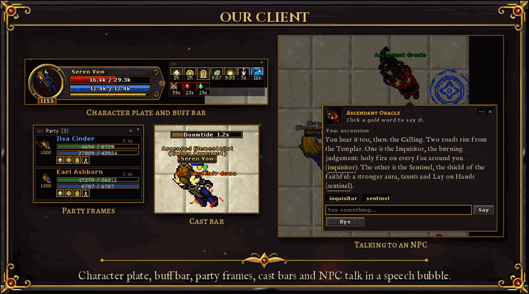

Cinders of Chaos ships its own client, built for these systems:
- **Ornate UI skin:** iron, gold trim, blood-red and arcane-blue gems on every window, button and bar, with titles and NPC
  text set in our own serif fonts.
- **Animated login screen:** the cathedral city over the lava, with embers, ash and a breathing logo. Press any key to start.
- **Top menu** with Character, Hunt, Adventure, Economy and Social, and a **character plate** in the corner of the map
  with your portrait, level, health, mana and experience.
- **Short numbers everywhere:** 12.4k, 2.45M, with the exact value in tooltips.
- **Combat feedback:** crits, dodges and reflects get their own effects. Elemental weapon damage shows as a separate
  coloured number with its element's effect. The energy shield is a bar above your health and has its own hit colour.
- **Cast bar** for cast-time spells, and the **chi pips** of the Monk.
- **Buff bar** right under the character plate, moving with it: your buffs and debuffs as small icons with a countdown
  and stacks, buffs first, debuffs in a blood-red frame, in rows as wide as the plate. Every icon is our own pixel art,
  in an ember-gold frame for buffs; class buffs show their spell's art. Hover for what each does. Class buffs, world
  buffs, events, Ember Blessings, Descent boons and raid debuffs are all there, and it is always right because the
  server sends it (Character > Buff Bar for the settings).
- **Party frames** (Hunt > Party Frames): a movable panel with every member's outfit, name in the class colour, level,
  health and mana, distance and floor, and their first buffs and debuffs. Click to target and follow, right-click for the
  party menu. Raids show all 15.
- **Monster bars** at the top of the map for the monster you fight, in seven styles: normal, magic, rare, legendary,
  boss, rift guardian and Omen guardian. Name and level on iron plates, a damage trail on the health, and the modifiers
  as icons under the bar with tooltips.

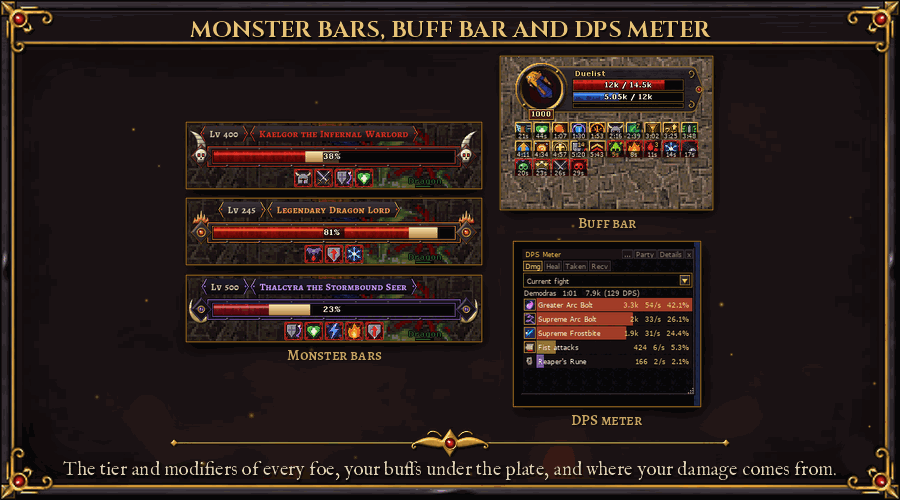

- **Sound:** the client is built with sound, and each loot filter rule can play its own short alert.
- **Toasts** for everything that matters: an achievement with its reward, a finished bounty, an item sold on the
  market, an invasion, a party invite. Every kind has its own icon, and invitations get iron and gold **Accept** and
  **Decline** buttons. Toasts stack without covering each other.
- **Level-up wings:** golden wings open behind a character that gains a level, and everyone on screen sees them.
  Options > Graphics > Effects turns them off for your own character or for others.
- **Riders sit right** on every mount, facing any direction.
- **Sharp sprites** on large screens, with a smooth upscaling filter.
- **Windows package:** the whole game for one Windows PC in one download, the patched server, the client with sound on,
  the art and a portable database, started with two .bat files. For local play and testing.

## Fair play

> *"The ladder is long. Climb it with your own hands."*
> (the Chronicler)

- **Only the official client plays.** Other clients and bots that speak the protocol themselves are refused at login,
  with a link to the download.
- **Two characters per IP at most.** While a second character is online from the same IP, neither can queue for a
  dungeon, enter the Infinity Tower or the arena, attack players, or give and take party bonuses.
- **Anti-bot checks:** the server watches for patterns no human keeps up for long (perfect spell rhythm, instant
  reactions, walked loops, nonstop play). One signal alone never triggers anything. A high score brings a short
  presence check: pick the right picture of four, with a retry, never during PvP or a boss fight. It never bans by
  itself; staff decide.
- **Player reports:** right-click a player or use System > Report a Player. Reports go to the staff with the public
  chat lines in question.
- **Staff characters** are left out of every leaderboard, title and reward.
- **The store sells no gear.** Gear comes from monsters, rifts, bosses, crafting and other players.
- **Chances mean what they say,** for crits, leech and every proc.
- **Bonuses have ceilings.** However many loot bonuses stack, the loot rate stops at 3x, and a kill never gives more
  than 4x its base experience. Events and boosts still help; they just cannot run away.
- **Instances stay closed.** The raid, the Ember Descent, the Ascended arenas, the guild boss and the battleground
  send strangers out, and no Town Portal, hideout or store teleport works inside any instance.
- **Accounts are protected** with salted password hashes, and the website locks out repeated failed logins. Sign-up
  has a captcha and a limit per IP, and the site runs on secure cookies with its pages guarded against script
  injection.
- **Season characters** play in their own economy, so a fresh season is a fair race.

## Coming soon

Being built right now:
- **The goblin and wildwood factions** on the live map, and more of our own art across the world.
- **Spell effect skins for the Necromancer line**, once its effects are redrawn.
- **Real group runs** of the raid, the Ascended bosses and the larger battlegrounds on the live server, and a measured
  balance pass for the item sets.

The full priority list is in [ROADMAP.md](ROADMAP.md).

---

## For developers

| Document | What's in it |
|---|---|
| [server/README.md](server/README.md) | layout, install steps, every Chaos system and its settings |
| [client/README.md](client/README.md), [client/MANIFEST.md](client/MANIFEST.md) | client modules, base patches, build |
| [docs/CLASSES.md](docs/CLASSES.md) | class design, roles and implementation status |
| [server/data/spells/README.md](server/data/spells/README.md) | spells and balance tables |
| [ROADMAP.md](ROADMAP.md) | what's done, in progress and planned |
| [docs/LAUNCH.md](docs/LAUNCH.md) | running a server and the Windows package: install, production config, services, backups, monitoring, launch checklist |
| [docs/BETA.md](docs/BETA.md), [docs/GM_HANDBOOK.md](docs/GM_HANDBOOK.md) | drafts for the owner: the open beta plan and the wipe before launch; staff groups, commands, reports, bans |
| [website/README.md](website/README.md) | the account website: installer, layout, class lock on character creation, leaderboards, patch notes and seasons pages, art |
| [CLAUDE.md](CLAUDE.md) | the checks CI runs, the architecture and the project rules |

**Fonts.** The client's titles, headings and NPC dialogue use free fonts under the SIL Open Font License 1.1:
Cinzel (The Cinzel Project Authors), Alegreya SC (The Alegreya Project Authors), Alegreya Sans (The Alegreya Sans
Project Authors), both by Huerta Tipográfica, and IM Fell English (Igino Marini). Their sources and licence texts are
in `client/fonts-src/` and ship with the client. The OFL lets them ship with the game; they may not be sold on their own.

This page is kept up to date as features are merged: new systems move from *Coming soon* into their sections.
